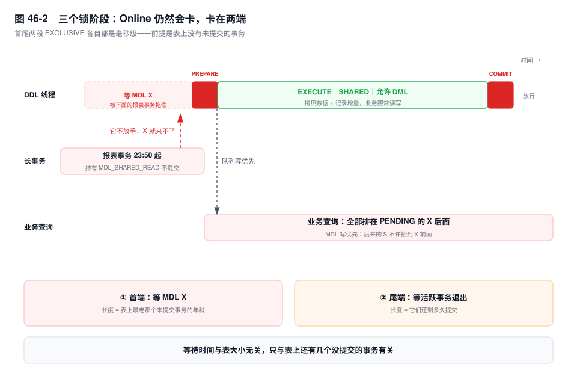
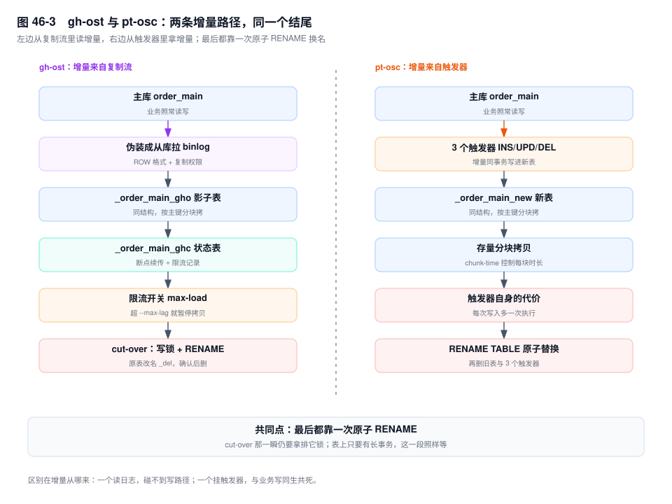

# 第 46 章　DDL 规范与在线变更

> **一句话结论**：`Online DDL` 保证的是"不长时间独占锁"，不是"不阻塞"；阻塞永远发生在首尾两次 `EXCLUSIVE`，长度由表上当时有多少未提交事务决定，与表有多大无关。

## 46.0 场景：加一个字段，全站卡了 40 秒

凌晨 2:00，运维在订单主表上执行：

```sql
ALTER TABLE order_main ADD COLUMN channel TINYINT NOT NULL DEFAULT 0, ALGORITHM=INSTANT;
```

5 亿行。执行前做过功课：测试库预演过、查过文档、确认 8.0.12 之后在末尾加列走 `INSTANT`，连 `ALGORITHM` 都显式写了。

2:00:03，这条语句进入 `Waiting for table metadata lock`。接下来的四十秒，`order_main` 上的每一条 `SELECT`、每一条 `INSERT` 都停在同一个 State 上，下单接口超时率跳到 60%。2:00:43，有人 KILL 掉一个 `Command=Sleep` 的报表连接，DDL 在半秒内结束——它真正干活的时间不到一秒。

卡住的不是 DDL。是 23:50 那个报表事务：它 `BEGIN` 之后读了一次 `order_main`，拿到 `MDL_SHARED_READ`，随后卡在数据导出上，一直没提交。DDL 要拿 `MDL_EXCLUSIVE`，只能排在它后面；而 MDL 队列不允许后来的读请求插队，于是新来的查询又全部排在 DDL 后面。**一个什么都没在干的连接，把整张表按住了四十秒。**

MDL 的分类与排队规则在第 18 章已经讲透，第 41 章案例五留着同一个现场的取证记录，这里只取一句：DDL 的风险不在 DDL 本身，在它排队的那一刻表上有什么。这一章回答的是后半句——知道这件事之后，给 5 亿行的表加字段，怎么做到业务无感。

## 46.1 三档算法：`COPY` / `INPLACE` / `INSTANT`


三档算法不是"新旧三代"，是三种做事的位置。

**`COPY` 建新表、逐行拷、换名。** 服务器按新结构建一张临时表，把原表的行一条条读出来、转成新格式、写进去，最后 `RENAME`。整个过程持有 `MDL_EXCLUSIVE`，读写都进不来。`5.6` 之前没有 online DDL 这个概念，改表就是建新表再拷——只有 `5.5` 的 Fast Index Creation 让加二级索引逃过一劫。所以那一代人对"改表要停服"的记忆是对的。

**`INPLACE` 在原表上做，但不等于"在线"。** 它省掉的是"整表复制一份再换名"，不是"不碰数据"。加二级索引可以在原表上直接构建，加列在 `5.7` 里仍然要重建整张表——只是重建过程中允许并发 DML，增量写进一块叫做 online log 的内存缓冲（`innodb_online_alter_log_max_size`，默认 128MB），改完再回放。**`INPLACE` 描述的是"在哪做"，`ONLINE` 描述的是"允不允许并发写"，这是两个维度**：加空间索引也是 `INPLACE`，但并发 DML 是被挡住的。

顺带一个会咬人的细节：那块 online log 是有上限的。DDL 跑得久、表上写得猛，缓冲先满，语句以 `Creating index ... required more than 'innodb_online_alter_log_max_size' bytes of modification log` 失败，白跑一遍。写完这段你就明白，为什么"大表加索引"要在低峰做——不是因为 DDL 慢，是因为低峰时那块缓冲不容易爆。

**`INSTANT` 只改数据字典，不碰行数据。** 8.0 的做法是：把新增列的定义写进数据字典，同时给表打一个"行版本"标记；老行里没有这一列，读的时候按行版本补出默认值。整个过程只改元数据，与表里有多少行毫无关系。

`INSTANT` 的真实范围要背准确，它是版本敏感度最高的一块：

| 操作 | 默认算法 | 允许并发 DML | 说明 |
|---|---|---|---|
| 末尾加列 | `INSTANT` `[8.0.12+]` | 是 | 只改字典 |
| 任意位置加列 | `INSTANT` `[8.0.29+]` | 是 | 8.0.29 之前要重建 |
| 删列 | `INSTANT` `[8.0.29+]` | 是 | 同上 |
| 调整列顺序 | `INSTANT` `[8.0.29+]` | 是 | 同上 |
| 改列类型 | 多为 `COPY`，少数 `INPLACE` | 多为否 | 行格式变了，多要重写 |
| 加二级索引 | `INPLACE` | 是 | 不重建表，但要扫全表 |
| 加唯一索引 | `INPLACE` | 是 | 结尾校验重复，有冲突即失败 |
| 改字符集 | `COPY` | 否 | 整表转码 |
| 改 `AUTO_INCREMENT` 值 | `INPLACE`（仅元数据） | 是 | 不碰行 |
| 加分区（RANGE/LIST） | `INPLACE` | 是 | HASH/KEY 要 `COPY` |

**有一条硬限制几乎没人提：每张表最多累积 64 次 instant 变更。** 行版本号在记录头里只占 7 位，用完就没了。第 65 次指定 `ALGORITHM=INSTANT` 会被直接拒绝，必须换 `INPLACE` 重建；而那次重建是实打实的全表拷贝，前面 64 次省下的时间，会在这一次连本带利还回去。可以用 `information_schema.INNODB_TABLES` 的 `TOTAL_ROW_VERSIONS` 看这张表已经用掉多少次，重建后归零。**"加字段很便宜"这句话，对一张干净的表成立，对一张被反复改过六十三次的表不成立。**

还有一笔隐性代价。`INSTANT` 之后，表里同时存在多个行格式版本：新写入的行有 `channel`，老行没有。全表扫描读到老行时要按行版本"补"出缺失的列，多一次判断和一次默认值填充。所以做完 instant 加列，**第一次全表扫描会略慢**，而且 `ALTER` 越多、版本越杂、判断链越长。这不是"没有代价"，是**代价从 DDL 挪到了查询**。加一列没事，一年加六十列就有事。

## 46.2 三个锁阶段：为什么"Online"仍然会卡



一条 online DDL 的生命周期只有三段，锁的强度是一条"高—低—高"的曲线：

| 阶段 | 持有的 MDL | 在做什么 | 被谁挡住 |
|---|---|---|---|
| `PREPARE` | `EXCLUSIVE` | 校验、确定算法、准备临时结构 | 表上所有活跃事务 |
| `EXECUTE` | `SHARED`（可升级） | 拷数据或改结构，接收并发 DML | 基本不被挡 |
| `COMMIT` | `EXCLUSIVE` | 等旧事务退出、写字典与 binlog | 仍在持锁的事务 |

首尾两段是排它的，中段是共享的。大量文章停在这里，得出"只有毫秒级抖动"的结论——**前提是表上没有长事务**。有长事务时，首段会从毫秒变成几十秒：

`PREPARE` 申请 `MDL_EXCLUSIVE`，而一个 `BEGIN` 之后读过这张表的事务持有 `MDL_SHARED_READ`，并且**持有到事务提交**。两者冲突，DDL 进队列等。它这一等，所有后来的读请求都排在它后面（否则排它锁可能永远拿不到），整张表就停在这里——46.0 的那四十秒，全部花在这一段。

`COMMIT` 阶段申请升级回 `EXCLUSIVE`，要等此刻仍持有 MDL 读锁的事务退出。注意等的是**事务**不是语句：一条已经执行完、但事务没提交的 `UPDATE`，仍然占着锁。好在此时 X 请求已经在队头，新的读写进不来，等待集合只减不增，所以这一段有界——除非控制不住的长事务正好卡在这时提交前的最后一条语句上。

那句最反直觉的话可以在这里说死了：**等待时间与表大小无关，与并发事务有关。** 5 亿行的表，如果表上只有短事务，`PREPARE` 和 `COMMIT` 各是毫秒级，中间拷数据的时间与表大小成正比但不挡业务；50 万行的表，如果有一个四小时没提交的只读事务，照样能卡四十秒。你在监控上看到的 `ALTER` 执行时间，九成不是它在干活。

还有一个默认值在帮倒忙：`lock_wait_timeout` 默认 31536000 秒，一年。DDL 等不到锁不会失败，会一直堵在队头，把所有请求一起拖住。生产上的 DDL 会话第一件事就是 `SET SESSION lock_wait_timeout = 5`，让它失败、让它重试，别让它排队。

## 46.3 原生 Online DDL 什么时候不够用

三类情况，遇到任何一类，原生 DDL 就不是"慢一点"的问题，是"不能用"。

**第一类，操作本身只能 `COPY`。** 改列类型（`INT` 改 `BIGINT`、`VARCHAR(64)` 扩到 `VARCHAR(512)` 跨过长度前缀边界）、整表转字符集、某些列重排，这些都要重写每一行。`ALGORITHM=INPLACE` 会直接报 1845，`LOCK=NONE` 也会报错——不是服务器不给你，是物理上做不到。5 亿行的表在 `COPY` 下全程独占，业务停到它结束。

**第二类，`INSTANT` 的次数用尽。** 前面说的 64 次。你以为在加第 65 个字段，实际在重建整张表；而工单上写的是"加列，instant，秒级"。

**第三类，表上有你控制不住的长事务。** 原生 DDL 没有"暂停"这个动作：它要么在跑，要么在等，要么失败。失败了，8.0 的原子 DDL 会回滚干净，但回滚本身可能要跑很久；重试又要从头排队。你需要的是一个**能随时掐断、掐断之后现场还在、下次能接着来**的方案。

工具的价值就在这三条上，不在"更高级"。它们的共同思路是：把"改结构"这件事从原表上挪走，在原表之外慢慢做，只在最后一瞬间回来换名字。**中间那段随便慢，两端仍然要独占——这一点没有任何工具能绕开。**

## 46.4 `gh-ost`：把自己伪装成一个从库



`gh-ost` 的核心是一句听起来很怪的话：它把自己注册成主库的一个从库。

链条是这样走的：

1. 连上主库（要加 `--allow-on-master`）或某个从库，**用复制协议向服务器要 binlog**，就像一台真的从库。因此它需要 `binlog_format=ROW`、`binlog_row_image=FULL`，以及 `REPLICATION SLAVE`、`REPLICATION CLIENT` 权限。
2. 建一张同结构的影子表 `_order_main_gho`，再建一张 `_order_main_ghc` 记状态（changelog）。`_ghc` 里存着拷到哪个主键、当前处于哪个阶段、上一次限流原因——进程被杀掉重启，从这张表接着来。
3. 按主键分块把存量拷进影子表，块大小由 `--chunk-size` 控制（默认 1000 行）。分块的意义不是快，是**每块之间可以去检查一次要不要暂停**。
4. 同时把 binlog 事件持续应用到影子表上。拷过的行被改了，binlog 里的事件会再改一次；没拷到的行被改了，事件先落进影子表，等拷贝追上时按"已存在则跳过"处理。这就是它不需要触发器的全部原因——**增量不是从写路径抓的，是从复制流里读的**。
5. `cut-over`：短暂地对原表加写锁，做一次原子的 `RENAME TABLE`，把影子表换成正式名，原表改名为 `_order_main_del`，确认无误后删除。

支撑它能在白天跑的是限流，不是勇气。`--max-load` 默认盯 `Threads_running=25`，`--max-lag` 盯从库延迟，`--critical-load` 是"越过就终止"的红线，`--throttle-query` 允许你塞一条自定义 SQL（返回非零就暂停）。这些阈值每检查一次，迁移就停一下；**它用"慢一点"换"不被业务感知"**，而这个交换只有在能暂停的前提下才成立。

代价要一并算清：

- 需要 `ROW` 格式与复制权限，某些托管实例不给这两个权限，方案直接不成立；
- 影子表要一份与表同量级的磁盘，加上迁移期间所有写入都会进 binlog，磁盘和 binlog 容量都要留余量；
- 它的写入会以行事件的形式复制到所有从库，**从库要额外回放一整份"影子表的写入"**，复制压力是平时的两倍量级；
- `cut-over` 那一瞬间仍然要拿写锁。`--cut-over-lock-timeout-seconds` 默认 3 秒，拿不到就退避重试、不动现场——这一步失败是安全的，但它确实会失败，而失败的原因往往还是那个：有长事务。

## 46.5 `pt-online-schema-change`：触发器方案

`pt-osc` 走的是另一条路：不读日志，改抓写路径。

1. 建新表 `_order_main_new`，结构是目标结构。
2. 在原表上建三个触发器 `pt_osc_shop_order_main_ins` / `_upd` / `_del`，把之后发生的每一次 `INSERT`、`UPDATE`、`DELETE` 同步写进新表。
3. 按主键分块把存量拷进新表，块大小由 `--chunk-time`（默认每块 0.5 秒）和 `--chunk-size-limit` 共同约束。
4. `RENAME TABLE order_main TO _order_main_old, _order_main_new TO order_main`，一步原子替换。
5. 删旧表、删触发器。

**触发器在同一个事务里执行，这是它最硬的优点。** 业务事务提交，原表的改动和新表的改动一起提交；业务回滚，两个一起回滚。增量不会丢，也不会重——它不需要像 `gh-ost` 那样处理"拷贝和 binlog 谁先到"的竞态，因为两条写入路径本来就在一个事务里。拷贝与触发器撞到同一行时（触发器先写、拷贝后到），pt-osc 用 `INSERT IGNORE` 与 `REPLACE INTO` 把冲突吃掉，这一点在它的触发器定义里看得见。

它的代价也来自同一个地方：**触发器给每一次写入都加了额外开销。** 一条 `INSERT` 变成"写原表 + 执行触发器 + 写新表"，一条 `UPDATE` 还要多一次按主键定位到新表。高写入表上，这段时间 QPS 会明显掉下来，而 `pt-osc` 的限流只能控制"拷贝"这一侧，控制不了触发器这一侧。

另外三条使用前提，缺一条就跑不起来：

- **表上不能已有触发器。** MySQL 从 `[5.7.2]` 起允许同一事件挂多个触发器，`pt-osc` 后来也提供了 `--preserve-triggers`，但默认行为仍是拒绝——它不想为一个它不认识的触发器负责。
- **必须有主键或唯一索引。** 分块靠它切；一个都没有时 `pt-osc` 直接拒绝执行——`--chunk-index` 只能指定用哪个索引，变不出一个唯一键来。
- **外键要显式处理。** `--alter-foreign-keys-method` 有 `auto`、`rebuild_constraints`、`drop_swap`、`none` 四档，选错会让子表在替换瞬间指向一张已经改名或即将删除的表。`drop_swap` 最快也最危险：它在 `RENAME` 前后有一小段窗口，子表查询会报错。

## 46.6 三者怎么选：一张判定表

| 你的处境 | 选它 | 理由 |
|---|---|---|
| 加列/删列，且 `TOTAL_ROW_VERSIONS` 远未到 64 | `INSTANT` | 只改字典，风险最低 |
| 加索引或可 `INPLACE` 的改动，且能控住长事务 | 原生 `INPLACE` + `LOCK=NONE` | 少一层工具，少一份磁盘 |
| 高写入表，要求随时暂停、失败可续 | `gh-ost` | 不碰写路径，限流完备 |
| 表上有触发器体系、无复制权限、表不大 | `pt-osc` | 触发器同事务，一致性最好 |
| 改列类型且不能停写 | `gh-ost` / `pt-osc` | 原生只能 `COPY` |
| 从库延迟本就紧张 | 先解决延迟，再谈工具 | 两者都会放大从库写入 |

给一句判断顺序：**能 `INSTANT` 就 `INSTANT`**，几秒结束、不产生额外表、不引入新依赖；**不能 `INSTANT` 但能 `INPLACE`，且你能保证窗口内没有长事务，用原生**；**写入压力大、需要长窗口、需要中断后接着来，用 `gh-ost`**；**表小、已有触发器体系、没有 binlog 权限，`pt-osc` 够用**。

比选错工具更危险的，是不写 `ALGORITHM` 和 `LOCK`。

不指定算法时，服务器会挑一个"它能用"的算法，而且不报错：你以为在跑 `INPLACE`，实际在跑 `COPY`，业务写入从第一条语句起就被挡住，直到结束。指定 `ALGORITHM=INPLACE, LOCK=NONE` 之后，做不到的会立刻以 1845 失败——**这个失败是你花钱买的保险**。DDL 工单里没有这两项，评审就不该通过；执行时如果不确定它在跑哪一档，看 `SHOW PROCESSLIST` 的 `State`：出现 `copy to tmp table` 就是 `COPY`，出现 `altering table` 才是 `INPLACE`。

## 46.7 大表 DDL 的前置检查与窗口选择

四项检查，缺一项就不要发语句。

**磁盘余量。** 原生 `COPY` 按"表大小 × 1"估（多一张新表）；工具方案按"表大小 × 2 + binlog 增量"估（影子表 + 原表并存，再加上迁移期间翻倍的 binlog）。表大小不能看 `du`，看数据字典：

```sql
SELECT TABLE_SCHEMA, TABLE_NAME,
       ROUND(DATA_LENGTH/1024/1024/1024, 1)  AS data_gb,
       ROUND(INDEX_LENGTH/1024/1024/1024, 1) AS index_gb
FROM information_schema.TABLES
WHERE TABLE_SCHEMA = 'shop' AND TABLE_NAME = 'order_main';
```

**当前长事务。** `trx_started` 早于五分钟的，逐个确认它能不能在窗口内结束；结束不了的，先处理它，再谈 DDL。

```sql
SELECT trx_id, trx_mysql_thread_id,
       TIMESTAMPDIFF(SECOND, trx_started, NOW()) AS age_s,
       trx_rows_modified, trx_is_read_only
FROM information_schema.innodb_trx
WHERE TIMESTAMPDIFF(SECOND, trx_started, NOW()) > 300
ORDER BY trx_started;
```

**复制延迟与从库负载。** 这一项最容易被漏掉：`gh-ost` 在主库跑，但从库要做两件苦活——回放影子表的全部写入，以及在最后执行那次 `RENAME`（DDL 会通过 binlog 传到从库，在从库上也要拿 `MDL_EXCLUSIVE`）。从库上如果正跑着一条长查询，`cut-over` 一样会卡在那里。

```sql
SHOW REPLICA STATUS\G   -- Seconds_Behind_Source [8.0.23+]、Replica_SQL_Running_State
SHOW GLOBAL STATUS LIKE 'Threads_connected';
SHOW VARIABLES LIKE 'max_connections';
```

**连接数余量。** DDL 期间被阻塞的请求不会消失，只会堆在连接池里。余量不足时，DDL 引发的不是"慢"，是 `ERROR 1040`。

窗口选择有一条反常识的规则：**不要只看业务低峰，要看长事务最少的时段。** 这两者常常不是同一个时间。凌晨两点 QPS 最低，但 23:50 的报表、1:00 的对账、2:30 的备份全挤在这个区间，恰恰是长事务最密集的时候；反倒是晚上十点业务还有余量、长事务一个都没有的时段更安全。判断依据不是监控大盘上的 QPS 曲线，是 `innodb_trx` 里 `age_s` 的历史分布——这一项值得单独做一张图。

## 46.8 关键结论

**1. `Online DDL` 保证的是"不长时间独占锁"，不是"不阻塞"。** 首尾两次 `EXCLUSIVE` 谁也躲不掉，所有工具只是把中间那段挪到了别处。

**2. 等待时间由事务决定，不由行数决定。** 5 亿行可能几秒改完，50 万行可能卡四十秒，差别在表上有没有一个没提交的读事务。

**3. `INSTANT` 只改元数据，上限是每表 64 次。** 第 65 次必须重建；代价也不是零，是从 DDL 挪到了每一次读老行。

**4. `gh-ost` 伪装成从库读 binlog，写路径零开销，但要 `ROW` 格式、复制权限和一份表大小的磁盘。** `cut-over` 那一下仍然要写锁。

**5. `pt-osc` 靠触发器同步增量，同事务所以不丢不重，代价是每次写入多一次。** 表上已有触发器时它默认不干。

**6. 不写 `ALGORITHM` 与 `LOCK`，等于把算法选择权交给服务器，而它不会告诉你它选了什么。**

## 46.9 实验验证

### 实验一：`INSTANT` 成功与失败各一次

```sql
-- 成功：末尾加列
ALTER TABLE order_main ADD COLUMN channel TINYINT NOT NULL DEFAULT 0,
  ALGORITHM=INSTANT;

-- 失败：改列类型，instant 做不到
ALTER TABLE order_main MODIFY COLUMN amount BIGINT NOT NULL,
  ALGORITHM=INSTANT;
```

```text
# 输出形态（未实跑，字段含义以此为准）
Query OK, 0 rows affected
Records: 0  Duplicates: 0  Warnings: 0

ERROR 1845 (0A000): ALGORITHM=INSTANT is not supported for this operation.
Try ALGORITHM=INPLACE.
```

第一条的 `0 rows affected` 是重点：**affected 行数为 0 不代表什么都没做，代表没有行被改写**。第二条要记住错误码，1845 的意思是"你要的算法这件事做不到"，不是语法错。

### 实验二：看这张表用掉了多少次 instant

```sql
SELECT NAME, TOTAL_ROW_VERSIONS, INSTANT_COLS
FROM information_schema.INNODB_TABLES
WHERE NAME = 'shop/order_main';
```

```text
# 输出形态（未实跑，字段含义以此为准）
NAME              TOTAL_ROW_VERSIONS  INSTANT_COLS
shop/order_main                    3             1
```

`TOTAL_ROW_VERSIONS` 是累计用掉的 instant 变更次数，逼近 64 就该按"下一次要重建"来排期；`INSTANT_COLS` 是通过 instant 加出来的列数。一次 `ALGORITHM=COPY` 的表重建会把前者清零。如果你的小版本上这两列不存在，用 `SHOW CREATE TABLE` 对比 `ROW_FORMAT` 与列顺序，只能看出"有没有多版本"，看不出次数——这时候就按"这张表历史上改过很多次"来保守评估。

### 实验三：在 `metadata_locks` 里看 DDL 排队

```sql
-- 会话 A：只读事务，不提交
BEGIN;
SELECT order_no FROM order_main WHERE id = 1;

-- 会话 B：任意 DDL
ALTER TABLE order_main ADD COLUMN settle_batch VARCHAR(32) NOT NULL DEFAULT '';

-- 会话 C：观察
SELECT OBJECT_NAME, LOCK_TYPE, LOCK_STATUS, LOCK_DURATION, OWNER_THREAD_ID
FROM performance_schema.metadata_locks
WHERE OBJECT_NAME = 'order_main';
```

```text
# 输出形态（未实跑，字段含义以此为准）
OBJECT_NAME  LOCK_TYPE     LOCK_STATUS  LOCK_DURATION  OWNER_THREAD_ID
order_main   SHARED_READ   GRANTED      TRANSACTION    51
order_main   EXCLUSIVE     PENDING      TRANSACTION    52
order_main   SHARED_READ   PENDING      STATEMENT      53
```

三行连起来读：51 号持有共享读锁且生命周期是 `TRANSACTION`（事务不结束就不放），52 号的排它锁在等，53 号的普通查询排在 52 后面。`LOCK_STATUS` 里那个 `PENDING` 就是"整张表停住"的全部现场。

### 实验四：`SHOW PROCESSLIST` 里的 State 变化

```sql
SHOW PROCESSLIST;
-- 另开一个会话，反复执行，盯 DDL 那一行的 State
```

```text
# 输出形态（未实跑，字段含义以此为准）
Id    Command  Time  State
52    Query     37   Waiting for table metadata lock      <- 首端排队
52    Query      2   altering table                       <- 正在改
52    Query      1   committing alter table to storage engine
```

三行是同一类语句在不同时刻的采样，`Time` 是当前这条语句已经跑了几秒，不要把它们当成同一次执行。`altering table` 是 `INPLACE` 在干活；如果这里换成 `copy to tmp table`，说明算法降级成了 `COPY`，业务此刻正在被挡住。`INSTANT` 太快，通常抓不到中间态，只会在 `Waiting for table metadata lock` 之后直接消失——抓不到不代表没等，只代表它干活的时间短。

## 46.10 常见误区

⚠️ **"8.0 加字段都是瞬时的"**
错在把"加列"当成一个操作。末尾加列是 `[8.0.12+]` 的 `INSTANT`，任意位置加列要到 `[8.0.29+]`；超过 64 次之后必须重建。正确理解：先问加在第几列、这张表改过多少次，再谈是不是瞬时。

⚠️ **"加索引一定会锁表"**
`5.6` 之前基本是对的，8.0 不是。加二级索引、唯一索引默认走 `INPLACE`，允许并发 DML，代价是要扫一遍全表并把增量记进 online log。正确理解：加索引不长时间锁写，首尾仍有极短的独占窗口；它会吃 IO，缓冲写满时整条语句失败。

⚠️ **"`LOCK=NONE` 就绝对不阻塞"**
`LOCK=NONE` 只约束中间那段：它要求"允许并发 DML"，做不到会报 1845。它管不了首尾两次 `EXCLUSIVE`，那两次由 MDL 决定，跟 `LOCK` 子句无关。正确理解：`LOCK=NONE` 挡的是"全程锁表"，挡不住"排队等一个长事务"。

⚠️ **"`gh-ost` 不需要磁盘空间"**
影子表就是一份完整的数据副本，与表同量级；迁移期间所有写入还会以行事件进 binlog，从库也要多回放一份。正确理解：磁盘按"表大小 × 2 + binlog 增量"准备，只多不少。

⚠️ **"DDL 慢是因为表太大"**
表大只影响中间拷贝那一段，而拷贝段允许并发 DML、业务无感。真正让业务有感的等待发生在首尾两段，长度取决于表上有多少未提交事务。正确理解：先看 `innodb_trx` 和 `metadata_locks`，再看行数。

## 46.11 生产 Checklist：DDL 上线的 12 项

**评估**

- [ ] 工单写明表名、列名、目标结构与预估行数，附 `information_schema.TABLES` 的数据量
- [ ] 写明本次操作的算法档位：`INSTANT` / `INPLACE` / 只能 `COPY`，并附依据
- [ ] 磁盘按"工具 × 2 + binlog 增量 / 原生 `COPY` × 1"备足；查过 `TOTAL_ROW_VERSIONS`，接近 64 的按重建重排窗口

**前置检查**

- [ ] `innodb_trx` 中 `age_s > 300` 的事务已清零，或确认其在本窗口内结束
- [ ] `metadata_locks` 中没有 `GRANTED` 且连接空闲的持有者
- [ ] 从库延迟在阈值内，且从库上没有跑超过阈值的长查询
- [ ] `Threads_connected` 距 `max_connections` 有足够余量

**执行**

- [ ] 语句显式带 `ALGORITHM=` 与 `LOCK=`；会话设 `SET SESSION lock_wait_timeout = 5`
- [ ] 工具方案先跑 `--dry-run`（pt-osc），确认生成的语句与触发器
- [ ] `cut-over` 的时点选在没有长事务的窗口，而不是"等业务闲了再说"

**观察**

- [ ] 执行中盯 `State` 与 `Threads_running`；工具限流被触发时记录原因，不要直接调高阈值

**回滚**

- [ ] `cut-over` 前后对比 `SHOW CREATE TABLE` 与 `COUNT(*)`；异常时保留原表，清理 `_gho` / `_new` / 触发器

## 46.12 延伸

- **前置**：第 18 章（MDL 的分类与排队规则）、第 21 章（长事务如何钉住 DDL）、第 31 章（表结构与字段默认值）、第 32 章（分区表的 DDL 差异）。
- **后续**：第 47 章（SQL 审核闭环，DDL 工单是其中一类）、第 43 章（跨版本升级时的 DDL 兼容性）。
- **面试追问**：
  - "8.0 加字段一定瞬时吗？" → 末尾 `[8.0.12+]`、任意位置 `[8.0.29+]`，且每表 64 次以内；超出即重建。
  - "`gh-ost` 为什么不需要触发器？" → 它以复制协议伪装成从库读 binlog，增量来自日志而不是写路径。
  - "DDL 卡在 `Waiting for table metadata lock`，该 KILL 谁？" → 不是 KILL DDL，是 KILL 那个持有 `MDL_SHARED_READ` 且 `Command=Sleep` 的连接。
- **官方文档**：`dev.mysql.com/doc/refman/8.0/en/innodb-online-ddl.html`、`.../innodb-online-ddl-operations.html`（每种操作支持哪档算法）、`.../innodb-online-ddl-performance.html`、`.../metadata-locking.html`；`gh-ost` 见 `github.com/github/gh-ost`；`pt-osc` 见 `docs.percona.com/percona-toolkit/pt-online-schema-change.html`。
