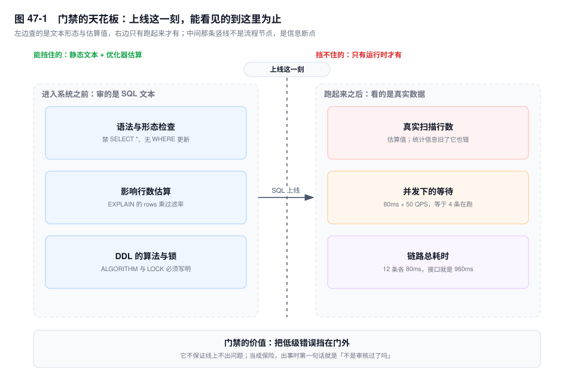
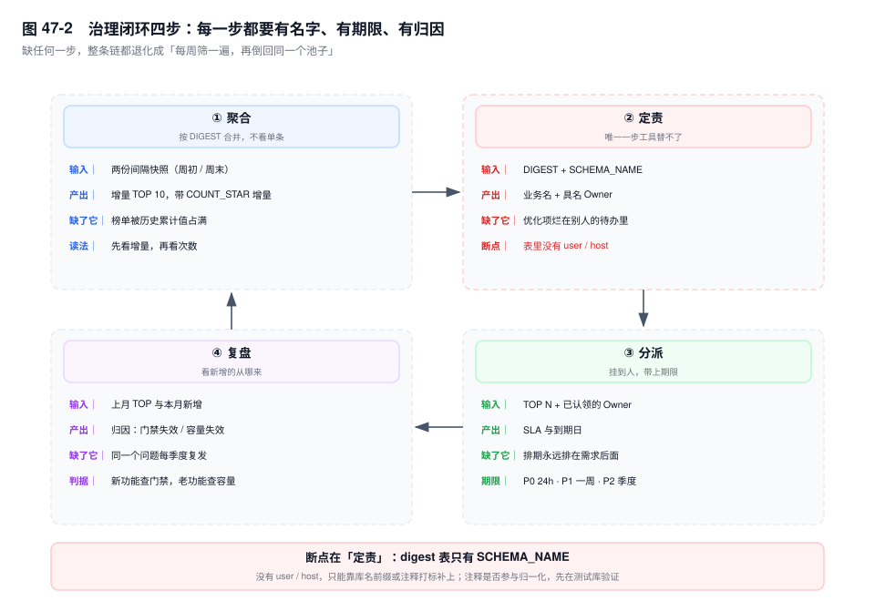

# 第 47 章　SQL 审核与治理闭环

> **一句话结论**：审核解决"进入系统的 SQL 长什么样"，治理解决"已经在跑的 SQL 谁负责"；只有门禁没有闭环，等于每周筛一遍，再倒回同一个池子。

## 47.0 场景：审核平台 100% 通过，第三周同一个问题又炸了一次

半年前的事故很朴素。一条 `UPDATE bill_settlement SET status = 2 WHERE merchant_id = 10086`，`merchant_id` 上没索引，扫了整张表，顺手锁住一片行，结算接口堵了四十分钟。事后上了审核平台，规则定得很硬：禁止 `SELECT *`，禁止不带 `WHERE` 的 `UPDATE` / `DELETE`，提交的 SQL 必须附 `EXPLAIN`，且 `key` 不能为空。

三个月里通过率 100%，评审会上被当成治理成效。第四个月的第三周，同一张表上出事的却是另一条语句：

```sql
SELECT bill_no, merchant_id, diff_amount
FROM bill_detail
WHERE merchant_id = 10086
  AND settle_date BETWEEN '2026-10-01' AND '2026-10-31';
```

`merchant_id` 与 `settle_date` 上各有一个索引，`EXPLAIN` 的 `key` 是 `idx_settle_date`，不是 `NULL`——规则条条通过。问题在于 `merchant_id = 10086` 只筛出两千行，而那一个月的 `settle_date` 有八十万行，优化器选了后者，八十万次回表把订单热页整片挤出缓冲池，全站 P99 跟着抬起来。

审核用的是一份两周前的样本数据，那时 `settle_date` 的分布还算均衡。**规则引擎匹配的是文本形态，漏掉的是数据分布**；而分布只有跑起来之后才有。

## 47.1 门禁能做什么，不能做什么



门禁（审核平台加发布卡点）能做的三件事，边界清楚。

**语法与形态检查。** `SELECT *`、不带 `WHERE` 的 `UPDATE` / `DELETE`、隐式类型转换（`WHERE merchant_no = 10086` 而列是 `VARCHAR`）、`OR` 拼接导致索引失效、`LIMIT 800000, 20` 这种深分页。它们的共同点：**只看 SQL 文本就能判定**，不需要知道表里有什么。

**影响行数评估。** 用 `EXPLAIN` 的 `rows` 乘一个过滤率，粗估这条语句会碰多少行。它给的是量级，不是精确值。

**DDL 的算法与锁声明。** 要求 `ALTER TABLE` 显式写 `ALGORITHM` 与 `LOCK`，把"静默退化成 `COPY`"挡在门外（第 46 章）。

不能做的三件事，每一件都有机制。

**看不见数据分布。** `rows` 是估算值，来源是索引统计信息或索引 dive，统计信息陈旧时它本身就是错的。第 41 章案例二就是这样漏过去的：批量导入 200 万行后没人 `ANALYZE`，优化器手里的基数还是旧分布，而 `IN` 列表一超过 `eq_range_index_dive_limit`（默认 200），估算就从逐值 index dive 退化成按统计信息折算，估出的行数严重偏小。审核时 `EXPLAIN` 显示走了索引，线上却整片扫。

**看不见执行时的并发。** 一条 80ms 的语句单看很干净，50 QPS 下它每秒占用 4 秒的数据库时间——按 Little's Law，`L = λW = 50 × 0.08 = 4`，稳态下等于 4 个连接被它按住。审核审的是一条语句的形状，不是它会被调用多少次。

**看不见链路。** 12 条各 80ms 拼成 900ms 的接口，任何一条单独提交都合格，慢日志也一条都抓不到（第 38 章）。

给一句判断：**门禁的价值是把低级错误挡在门外，不是保证线上不出问题。** 把它当成后者，出事时第一句话一定是"不是审核过了吗"——这句话的潜台词是，团队已经把门禁当成了保险。

## 47.2 规则引擎的三档设计，以及"为什么规则会被绕开"

| 档位 | 处置 | 典型条目 |
|---|---|---|
| 禁止 | 阻断上线，必须改 | 无 `WHERE` 的 `UPDATE` / `DELETE`、新建无主键表、`ALTER` 不写 `ALGORITHM` |
| 警告 | 可申请豁免，留下记录 | 预计扫描行数超 10 万、单事务影响行数超 5000、`IN` 列表超 100 个值 |
| 建议 | 只提示，不阻断 | 建议补覆盖索引、建议把 `OR` 改写为 `UNION ALL` |

**禁止项必须少而硬。** 每加一条禁止项，就多一批"这次是运营需求，先上"的豁免申请；豁免多了，规则就形同虚设。有一条判据：某个禁止项半年内的豁免率超过三成，它其实是警告项，只是没人愿意承认。

**警告项要能被数据验证。** "预计扫描行数超 10 万"比"禁止 `LIKE '%x'`"可执行得多——前者有数字，能拿去和线上实际的 `SUM_ROWS_EXAMINED` 对照；后者只能靠人辩论"这个模糊查询到底该不该存在"。

规则被绕开的三条路径，都见过：

1. **拆分语句。** 一条删 50 万行的大 `DELETE` 被拆成循环单行删除，规则条条通过，事务数从 1 变成 50 万，undo 保留和从库回放一起被拖垮。
2. **换写法。** `WHERE merchant_id = 1 OR bill_no = 'X'` 改成两个 `UNION` 子查询，审核看两条都走索引，实际执行时各扫一遍再合并，总扫描量翻倍。
3. **走豁免。** 审批单上写"临时活动，三天后下线"，三个月后这条 SQL 还在跑，豁免单没人回头关。

三条路指向同一件事：**规则约束的是文本，业务优化的是结果。** 文本可以变形，结果不会。

## 47.3 从 digest 到责任：治理闭环的四件事



四步里，只有第一步能靠工具做完。

**聚合：看增量，不看累计。** 按 `DIGEST` 汇总，取两次快照的差。`SUM_TIMER_WAIT` 的增量回答"这一周谁在消耗数据库"，`COUNT_STAR` 的增量回答"它是被调用得多，还是单次特别慢"。这两张榜的结论经常相反（第 38 章）：总量第一往往是高频简单查询，单次第一往往是低频报表。处置动作完全不同——前者压调用频次、加缓存；后者改 SQL、加索引。用一张榜覆盖两种病，等于拿退烧药治骨折。

**定责：这一步工具替不了。** `events_statements_summary_by_digest` 只有 `SCHEMA_NAME`，没有用户，也没有主机。它能回答"哪条最贵"，回答不了"这条归谁"。补这个缺口只有两条路：

- 库名带业务前缀（`trade_order`、`bill_settle`、`stock_center`），把库当作归属的第一层；
- 在 SQL 注释里打标：`/* app=order,api=createOrder */`。

第二条路有个必须先验的前提：**注释是否参与 digest 归一化，各版本行为不一致。** 如果注释被算进 `DIGEST_TEXT`，同一条 SQL 换个接口名就是另一个 digest，一个业务会被拆成几十个 digest，聚合直接失效；如果注释被剥掉，打标对 digest 毫无作用，只能退回库名加表名。上线前在测试库验一次（见 47.7 实验二），比事后猜便宜。

**分派：挂到人，带上期限。** TOP N 的 digest 挂到具体的人，不是"后端组"。带 SLA：P0 级（影响下单、结算）24 小时内给方案，P1 级一周内，P2 级进季度排期。**没有 Owner 的优化项一定会烂在待办里**：它不在任何人的考核里。

**复盘：看新增的从哪来。** 每月看一次"本月新进 TOP 10 的 digest 是什么"。如果全来自新上线的功能，说明门禁失效，回去补规则；如果全来自老功能的数据增长，说明容量规划失效，该谈归档、分库或读分流（第 51 章）。这个视角比"本月优化了多少条"有用：后者只统计动作，前者判断机制还在不在。

治理的产出不是"消灭了慢查询"，是**每个慢查询都有一个名字**。名字意味着有人认领、有期限、有下一次检查。

## 47.4 运行时防线：超时、限流、熔断

门禁拦不住的那部分，靠运行时的三道闸。

**语句级超时。** `MAX_EXECUTION_TIME`（毫秒）只对只读 `SELECT` 生效，超时抛 `ERROR 3024 (HY000)`。它对 `UPDATE`、`DELETE` 一律无效，写语句的超时只能靠批大小与 `innodb_lock_wait_timeout` 兜（第 35 章）。

**代理层规则。** ProxySQL 的 query rules 能按 digest 匹配，命中后改写、拒绝或打标。两个代价：匹配的仍是归一化后的**文本**，47.2 那三条路径它挡不住；多一层代理就多一跳延迟、多一个故障点。

**连接池侧的并发闸门。** 最有效的一道。用信号量限制"同时有多少条 SQL 在跑"，直接压住 Little's Law 里的 `L`；`L` 被压住，`W` 就不会因为排队而膨胀。代价是超出的请求要在应用侧等待或快速失败，所以阈值必须和池上限、数据库核数一起算。

排序原则：**运行时防线按"能不能止损"排，不按"能不能预防"排。止损要快、要能自动；预防再慢都行。** 出事时没有人有空等人审批一条规则。

## 47.5 数据访问层的三条硬规范

**N+1。** ORM 的懒加载在列表页会把 1 条 SQL 变成 N+1 条。症状很特别：QPS 很高，每条都很快，digest 榜上全是同一个 `SELECT ... WHERE id = ?`。治理时盯 `COUNT_STAR` 的增量，别按 `AVG_TIMER_WAIT` 排序——按单次耗时它永远进不了前二十。

**批量接口。** `INSERT INTO ... VALUES (...),(...),...` 一次 500 行，比循环 500 次快一个量级，省的是 500 次往返与解析。两个边界：单条语句超过 `max_allowed_packet` 直接失败，包大小要按行宽在应用侧估算；一个事务写太多行会拉长从库回放（第 25 章），500 到 1000 行一批是常见折中。

**强制分页。** 列表查询没有 `LIMIT`，数据涨十倍后必然出事：扫描量线性增长，接口预算不变。深分页要换游标（`WHERE id > last_id ORDER BY id LIMIT 20`），`LIMIT 800000, 20` 在服务端要先丢掉 80 万行（第 15 章）。

## 47.6 关键结论

1. **规则引擎匹配文本，漏掉的是数据分布。** 形态错误能挡，分布错误只能靠运行时数据发现。
2. **门禁不保证线上不出问题，它只保证低级的形态错误不进系统。** 把它当保险，复盘就会退化成追责。
3. **`SUM_TIMER_WAIT` 与 `COUNT_STAR` 的增量是两张不同的榜**，前者找"谁最贵"，后者找"谁最频繁"，处置动作不通用。
4. **digest 表没有用户和主机维度，定责必须靠约定补。** 库名前缀或注释打标，后者要先验证注释是否参与归一化。
5. **没有 Owner 和期限的优化项，一定会回到榜上。** 治理的产出是"每条慢 SQL 有个名字"，不是"这周优化了几条"。
6. **运行时防线按止损能力排序。** 超时、限流、闸门要能自动生效，等审批来不及。

## 47.7 实验验证

### 实验一：周增量 TOP 10

```sql
-- 周初快照
CREATE TABLE perf.digest_w0 AS
SELECT DIGEST, SCHEMA_NAME, DIGEST_TEXT, COUNT_STAR,
       SUM_TIMER_WAIT, SUM_ROWS_EXAMINED, SUM_ROWS_SENT
FROM performance_schema.events_statements_summary_by_digest;

-- 一周后取第二份
CREATE TABLE perf.digest_w1 LIKE perf.digest_w0;
INSERT INTO perf.digest_w1
SELECT DIGEST, SCHEMA_NAME, DIGEST_TEXT, COUNT_STAR,
       SUM_TIMER_WAIT, SUM_ROWS_EXAMINED, SUM_ROWS_SENT
FROM performance_schema.events_statements_summary_by_digest;

SELECT n.SCHEMA_NAME,
       LEFT(n.DIGEST_TEXT, 60) AS digest_text,
       n.COUNT_STAR - COALESCE(o.COUNT_STAR, 0) AS calls_delta,
       ROUND((n.SUM_TIMER_WAIT - COALESCE(o.SUM_TIMER_WAIT, 0)) / 1e12, 1) AS total_s_delta,
       ROUND((n.SUM_TIMER_WAIT - COALESCE(o.SUM_TIMER_WAIT, 0)) / 1e9
             / NULLIF(n.COUNT_STAR - COALESCE(o.COUNT_STAR, 0), 0), 2) AS avg_ms,
       ROUND((n.SUM_ROWS_EXAMINED - COALESCE(o.SUM_ROWS_EXAMINED, 0))
             / NULLIF(n.COUNT_STAR - COALESCE(o.COUNT_STAR, 0), 0)) AS rows_per_call
FROM perf.digest_w1 n
LEFT JOIN perf.digest_w0 o USING (DIGEST)
WHERE n.COUNT_STAR > COALESCE(o.COUNT_STAR, 0)
ORDER BY total_s_delta DESC
LIMIT 10;
```

```text
# 输出形态（未实跑，字段含义以此为准）
SCHEMA_NAME  digest_text                    calls_delta  total_s_delta  avg_ms  rows_per_call
trade_bill   SELECT `bill_detail` . `bill_no` ...   18240          412.6    22.6           43800
trade_order  SELECT `order_main` . `order_no` ...   98210           88.4     0.9              12
```

第一行一万八千次、每次 22ms、扫四万多行，是索引选择性差；第二行九万八千次、每次 0.9ms、扫 12 行，是高频小慢。两行都在榜上，处置不同——前者改索引，后者减调用。

### 实验二：注释是否参与归一化

```sql
SELECT 1 /* app=probe,api=alpha */;
SELECT 2 /* app=probe,api=beta */;

SELECT DIGEST, DIGEST_TEXT, COUNT_STAR
FROM performance_schema.events_statements_summary_by_digest
WHERE DIGEST_TEXT LIKE '%probe%' OR DIGEST_TEXT = 'SELECT ?';
```

```text
# 输出形态（未实跑，字段含义以此为准）

-- 情况 A：注释被剥掉，两条合并
DIGEST      DIGEST_TEXT   COUNT_STAR
0x8f2c...   SELECT ?      2

-- 情况 B：注释参与归一化，两条分开
DIGEST      DIGEST_TEXT                              COUNT_STAR
0x8f2c...   SELECT /* app=probe,api=alpha */ ?       1
0x1a77...   SELECT /* app=probe,api=beta */ ?        1
```

情况 A 说明打标对 digest 无效，定责只能靠 `SCHEMA_NAME` 加表名；情况 B 说明打标可用，但标签必须由统一的注解模板生成——手写注释里多一个空格、换一种引号，都可能变成新的 digest。

### 实验三：`max_execution_time` 对 `UPDATE` 无效

```sql
SET SESSION max_execution_time = 100;   -- 100ms

-- 期望被掐断，实际跑满：写语句不受该参数约束
UPDATE bill_detail SET memo = 'probe'
WHERE id = 1 AND SLEEP(1) = 0;

-- 对照：同样的上限对 SELECT 生效
SELECT SLEEP(1);
```

```text
# 输出形态（未实跑，字段含义以此为准）
Query OK, 0 rows affected (1.00 sec)          -- UPDATE 未被中断

ERROR 3024 (HY000): Query execution was interrupted,
maximum statement execution time exceeded      -- SELECT 被中断
```

`SLEEP(1) = 0` 恒为假，一行都不改，但服务端照样执行满一秒。`UPDATE` 返回成功，说明 100ms 的上限根本没作用在写语句上；`SELECT` 报 3024，说明参数本身是生效的。

## 47.8 常见误区

⚠️ **"上了审核平台就不会有慢查询"**
错在把形态检查当成分布检查。平台证明的是写法，不是真实数据上的访问路径。47.0 那条语句 `key` 不为空、规则全过，线上依然扫了八十万行。正确理解：审核降低的是低级错误的发生率，慢查询的发现仍要靠 digest 与运行时数据。

⚠️ **"慢查询日志能覆盖所有慢"**
慢日志的判据是单条语句超过 `long_query_time`。12 条 80ms 的链路、5ms × 1 万 QPS 的高频调用，一条都不会进日志（第 38 章）。正确理解：慢日志抓"越线的单条"，digest 增量抓"总量"，两者不能互替。

⚠️ **"优化完就不用管了，会一直好下去"**
执行计划随数据分布漂移，业务量会涨。第 41 章案例二在 `ANALYZE` 之后恢复，两个月后同一条 SQL 因为 `IN` 列表继续变长又慢了一次。正确理解：优化有半衰期，回归验证要进周期节奏，而不是随项目结项。

⚠️ **"把规则调严一点就安全了"**
规则越严，豁免越多；豁免越多，规则越像摆设。何况规则只约束文本，拆分与换写法都能合规通过。正确理解：规则的目标是高信噪比，不是全覆盖；覆盖不了的部分交给运行时防线和每月复盘。

## 47.9 生产 Checklist：治理机制自检的 10 项

- [ ] 禁止项是否控制在个位数？每条禁止项近半年的豁免率是多少？
- [ ] 警告项是否都带可验证的数字，而不是"禁止某种写法"？
- [ ] 每条豁免申请是否有到期时间，到期后是否自动回到审核？
- [ ] digest 快照是否按天落库（`performance_schema` 重启即清空，没落库等于没数据）？
- [ ] 每次排 TOP 用的是增量（两次快照之差），不是累计 `SUM_TIMER_WAIT`？
- [ ] 每条 TOP SQL 是否有具名 Owner（人名，不是"后端组"）与 SLA 期限？
- [ ] 业务与 digest 的映射靠什么建立？注释打标在测试库验证过吗？
- [ ] 每月是否对"新增 TOP digest"做归因，区分新功能与数据增长？
- [ ] `MAX_EXECUTION_TIME` 设置了吗？团队清楚它不约束写语句吗？
- [ ] 连接池是否有并发闸门，阈值按核数与池上限算过吗？

## 47.10 延伸

- **关联章节**：第 15 章（查询改写与深分页）、第 25 章（大事务与从库延迟）、第 35 章（`max_execution_time` 的边界）、第 36 章（三层定位法）、第 38 章（慢日志与 digest 表）、第 41 章（案例二：合规 SQL 引发雪崩）、第 46 章（DDL 算法与锁）、第 51 章（容量规划）。
- **面试追问**：
  - "SQL 审核平台能挡住慢查询吗？" → 能挡住形态类的（无索引、无 `WHERE`、`SELECT *`），挡不住分布类的（统计信息陈旧、索引选错）和并发类的（高频小慢、链路叠加）。前者靠规则，后者靠 digest 增量与运行时防线。
  - "为什么 digest 榜的 TOP 1 常常不是最该优化的那条？" → 总耗时第一多是高频简单查询，优化空间只有几毫秒。要看 `COUNT_STAR` 增量与 `rows_per_call`，把"高频"和"单次巨慢"分开处置。
  - "治理闭环里哪一步最容易断？" → 定责。digest 表没有用户与主机维度，必须靠库名约定或注释打标补上；缺了这一步，优化项没有 Owner，三个月回到原点。
- **官方文档**：`MySQL 8.0 Reference Manual` → `Performance Schema` → `Statement Digests`；`Server System Variables` → `max_execution_time`；`MySQL Server Error Reference` → `3024`；ProxySQL 文档 `Query Rules`。
