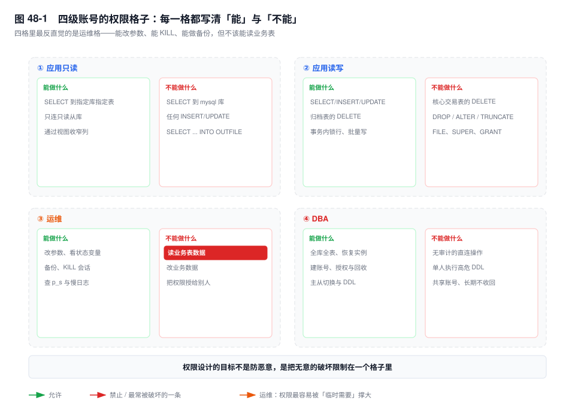
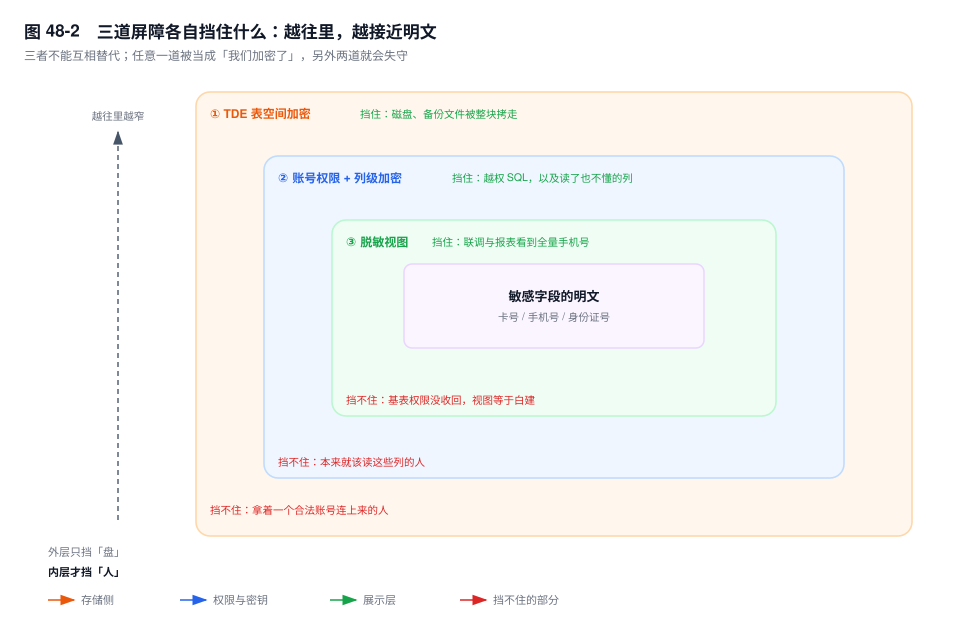

# 第 48 章　权限、安全与合规

> **一句话结论**：权限设计的目标不是"防止恶意"，是把无意的破坏限制在一个格子里；线上九成的数据事故，是一个有权限的人做了一件不该做的事。

## 48.0 场景：一条 DELETE 少了 WHERE，账号是"运维只读"

16:40，开发在线上执行了一条语句，漏了后半截条件：

```sql
DELETE FROM order_main WHERE merchant_id = 10086;
```

四十万行历史订单消失。复盘会上所有人卡在同一个疑问：执行者用的是 `ops_ro`，一个名字里带"只读"的账号。

`SHOW GRANTS` 一行就解释完了：

```sql
GRANT ALL PRIVILEGES ON *.* TO `ops_ro`@`10.0.0.%` WITH GRANT OPTION
```

三年前为跑一次数据修复临时给了 `ALL`，说好"跑完就收"。那次跑完了，收回没做。此后这个账号一直被当成只读账号在用——**名字是只读的，权限是全权的**，没有机制保证两者一致。

权限的腐蚀不是一次错误授权，是一百次"先给了，回头再收"，而回头从没发生。恢复过程见第 41 章案例十与第 28 章；本章只问一句：如果它当初只被允许 `SELECT` 三张表，那条语句会在第几秒失败？

## 48.1 四级账号模型：把人分成四类就够了

按"他要做什么"分四类，比按部门分有效（图 48-1）。



**应用只读**：`SELECT` 到具体库的具体表，`mysql` 库一律不给——`mysql.user` 有口令哈希，`mysql.role_edges` 有全部授权关系，读出来等于把整库钥匙拓了一份。

**应用读写**：`SELECT/INSERT/UPDATE/DELETE`，但核心交易表不给 `DELETE`，只给逻辑删（`status` 改作废）；不给 `DROP/ALTER/TRUNCATE`，误执行的 `ALTER` 比误删更难回滚（第 46 章）。物理删除走归档任务，用一个只碰归档表的账号。

**运维**：能改参数、看状态、做备份、`KILL`，**不能读业务表数据**。这条最常被"运维要排障啊"顶回来。排障要的是 `SHOW PROCESSLIST`、`performance_schema`、`SHOW ENGINE INNODB STATUS`、慢日志，没有一条需要 `SELECT * FROM order_main`。真要看某一行，走申请和脱敏视图，把看数据变成一次留痕的动作。

**DBA**：全权，绑三个条件——强认证（不允许单因子口令直连）、操作审计、双人复核（`DROP`、`TRUNCATE`、大批量 `DELETE` 两人在场）。

三条实现约束比分类本身更重要。

**库表级授权，不要 `*.*`。** 写 `GRANT SELECT ON trade_order.* TO ...`：`*.*` 会让**以后新建的库**自动落进这个账号的权限范围，而你不会有感知。

**认证与授权分开写。** `CREATE USER 'app_order'@'10.0.0.%' IDENTIFIED WITH caching_sha2_password BY '...';` 再单独 `GRANT`。把插件和口令塞进 `GRANT` 那一行，半年后改口令一定漏某个 host（见 42.5）。

**用角色 `[8.0]` 把一组权限变成对象。** 建 `CREATE ROLE rw_trade`，把表级权限授给角色，再 `GRANT rw_trade TO ...`，回收时一句 `REVOKE` 干净。坑在：角色还要 `SET DEFAULT ROLE` 才会登录时自动激活，否则 `SHOW GRANTS` 看着对，业务连上来照样 1142。

## 48.2 `FLUSH PRIVILEGES` 到底在做什么

这是被误解最多的一条命令。

`GRANT` / `REVOKE` 在一条语句里同时改两处：内存里的 ACL 和 `mysql` 库的授权表。两者同时更新，**立刻生效，不需要 flush**。权限检查发生在每条语句执行之前，不是连接时一次性缓存，老连接的下一条语句就能看到新权限。

`FLUSH PRIVILEGES` 干的是另一件事：把授权表重读进内存。它只在"内存与表不一致"时才有意义，也就是有人绕过 `GRANT` 直接改了表。

`[8.0]` 起 `mysql.user` 是数据字典之上的视图，直接 DML 会被拒绝，这条命令的现实用途只剩"用文件级方式恢复过授权表之后"。`[5.7]` 及更早直接 `UPDATE mysql.user`，是做得到但从不该做的事。

**正常用 `GRANT` 的团队，这条命令一次都不该执行。** 变更记录里看到它，该查的不是"权限为什么没生效"，而是"谁在直接改授权表"。

两个坑都跟 host 有关。

`'app'@'10.0.0.%'` 与 `'app'@'localhost'` 是**两个不同的账号**：`mysql.user` 里各占一行，口令、权限、`account_locked` 全独立。

host 匹配精确优先于 `%`：本机 socket 连上的是 `localhost`；用 TCP 连 `127.0.0.1` 匹配 `127.0.0.1` 或 `%`，**不匹配 `localhost`**。所以"我在本机验过"经常是在说另一个账号。

## 48.3 SQL 注入：真正的防线只有一条

参数化（预编译），别的都是兜底。

机制上为什么能根治：SQL 文本先被解析成语法树，参数在**语法树成型之后**才绑定进来，绑的是值，不是文本。参数里写 `' OR 1=1 -- ` 也只是往一个字符串位置塞了一段字符串，它进不了语法树，不可能改变语义。这是唯一一条从根上成立的防线。

兜底各有边界：最小权限决定"注入成功之后能拿到什么"，`sql_mode` 让畸形输入更容易报错，WAF 挡已知 payload。**转义函数不是防线**——它的正确性依赖字符集与 `NO_BACKSLASH_ESCAPES` 的组合，两者一变，`\'` 就不再是转义符（48.8 有可复现的验证）。

那为什么注入还在发生？有三处参数化管不到。

**ORM 的自定义片段。** 框架的参数化只覆盖它自己生成的部分，`whereRaw("merchant_id = " + id)` 一写，前面所有保护归零。

**标识符。** 表名、列名、`ORDER BY` 的字段、`ASC/DESC` 都进不了占位符——占位符只能绑值。这里只能白名单映射：`sort=amount_desc` 映射到固定的 `amount DESC`，其他一律拒绝。

**存储过程里的动态 SQL。** `PREPARE stmt FROM CONCAT('... WHERE merchant_id = ', p_id);` 把参数拼进语句文本再解析，等于自己把预编译的保护撤销了。要么用 `USING` 绑定，要么别在存储过程里拼语句。

## 48.4 加密与脱敏：三件不同的事

"我们加密了"这句话能通过评审会，过不了复盘会，因为它没回答"防谁"（图 48-2）。



**TDE**（InnoDB 表空间加密 + keyring）。加解密发生在页读写路径上：数据页从磁盘读入时解密，刷盘前加密。挡的是**文件被拿走**：磁盘下线、备份被拷、快照被共享。挡不住任何一条合法连接——有 `SELECT` 权限的人看到的就是明文，解密在引擎里完成，对他完全透明。代价也在 IO 路径上，多一次加解密，CPU 开销通常可接受，但必须实测，压缩表叠高 IOPS 时要单独测。

**列级加密**。MySQL 没有原生列加密，只能应用层做，或用 `AES_ENCRYPT` 存成 `VARBINARY`。代价是结构性的：密文没有顺序，**不能范围查询、不能排序、不能建普通索引**；要等值查就再加一列存哈希（`SHA2(卡号,256)`），而哈希列防彩虹表要加盐，加了盐又不能等值查。这条约束决定了它只能用在范围极小、敏感度极高的字段：身份证、卡号。把订单金额加密，等于把对账系统废掉。

**脱敏视图**。给开发、分析用的视图，手机号中间四位打码、地址只留到区。本质不是加密，是**换一个权限对象**：让这些人拿到视图，不是表。前提是基表权限没给他们——基表权限还在，视图只是多开一道门，`SELECT * FROM order_main` 照样看全量。这是三者里最容易破功的一道，因为"临时给一下基表权限"太顺手。

一句话钉住：**TDE 防"拿走盘"，列加密防"有权限的人"，脱敏防"不该看全量的人"。**

## 48.5 审计：社区版没有官方方案

`audit_log` 插件是企业版特性，社区版**没有**官方审计插件，方案文档里必须写清楚。

社区版只有三条路，每条都有代价。

**`general_log`。** 记录所有到达服务器的语句。每条语句的路径上多一次写，代价随 QPS 线性上升；`log_output=TABLE` 更重，写表要加锁、要生成 undo。只能短时开，用于取证一个已知时间窗。

**旁路。** 代理层（ProxySQL 查询日志）或网络抓包。不过 mysqld 进程，主库性能不受影响；代价是多一跳要维护，包得自己解析，有 TLS 还得有证书。

**应用层埋点。** 在数据访问层记录"谁、什么时候、查了哪个商户的哪张单"。最能定位到业务，但覆盖不到 DBA 直连和运维手工执行的语句——而这两类恰恰最需要审计。

判断：**合规场景基本只能用企业版或云上的审计服务**。社区版想"事后能查"，更现实的做法是"事前不给权限"——审计是补救，权限是预防。

## 48.6 合规落到 MySQL 上长什么样

等保 2.0 落到库上是三件事。**身份鉴别**：口令强度与有效期、不共享账号——一个账号多人使用，后面所有审计都失效。**访问控制**：最小权限加分离职责，能改参数的人和能读业务数据的人不该是同一个。**安全审计**：日志留存不少于六个月，且执行者自己删不掉。

数据出境：跨境传输要先做安全评估。落到库上是部署问题，不是参数问题——库能不能放在境外区域、备份能不能落到境外对象存储、只读副本算不算传输。"我们只读不导出"不成立，从库上有同样的明文。

删除权：要删的不只是业务表那几行。从库、延迟副本、备份、导出的报表、下游数仓，全是副本。备份里定点删除不成立（备份是只读快照），现实做法是两条：**备份按保留期自然过期**，并**给每次删除请求做台账**——请求时间、涉及的备份集、预计最晚过期日。这件事没人做完整，能做的是"说清楚从哪天起才真的没有"。

## 48.7 关键结论

1. **权限的目标是把无意的破坏限制在一个格子里，不是防恶意。** 按这个目标设计，才会去限制自己人。
2. **`GRANT` 立刻生效；`FLUSH PRIVILEGES` 只服务直接改授权表的场景。** 看到它，先怀疑有人在绕开 `GRANT`。
3. **参数化是唯一从根上成立的注入防线**，它让参数进不了语法树；转义函数依赖字符集与 `sql_mode` 的正确性，不是防线。
4. **TDE、列加密、脱敏是三件事**：防拿走盘、防有权限的人、防不该看全量的人，互不能替代。
5. **社区版没有官方审计插件。** 合规要么企业版要么云服务；社区版的现实策略是事前不给权限。
6. **同名不同 host 是两个账号。** 第一现场永远是 `SHOW GRANTS` 加 `SELECT user, host FROM mysql.user`。

## 48.8 实验验证

### 实验一：看清一个账号的真实权限

```sql
SHOW GRANTS FOR 'ops_ro'@'10.0.0.%';
SHOW GRANTS FOR 'app_order'@'10.0.0.%' USING rw_trade;
```

```text
# 输出形态（未实跑，字段含义以此为准）
Grants for ops_ro@10.0.0.%
GRANT ALL PRIVILEGES ON *.* TO `ops_ro`@`10.0.0.%` WITH GRANT OPTION

Grants for app_order@10.0.0.%
GRANT USAGE ON *.* TO `app_order`@`10.0.0.%`
GRANT `rw_trade`@`%` TO `app_order`@`10.0.0.%`
```

第一段说明这个"只读"账号能删任何库的表，`WITH GRANT OPTION` 还意味着它能转授；`USAGE` 是"能登录但无权限"的占位符，真权限在角色上，要加 `USING` 才看得见。

### 实验二：同名账号到底有几个

```sql
SELECT user, host, plugin, account_locked
FROM mysql.user
WHERE user = 'app_order'
ORDER BY host;
```

```text
# 输出形态（未实跑，字段含义以此为准）
user        host        plugin                account_locked
app_order   %           caching_sha2_password  N
app_order   10.0.0.%    caching_sha2_password  N
app_order   localhost   mysql_native_password  N
```

三行三个账号：插件可能不同（一行还是老插件，升级后就是雷），锁定状态也可能不同。按 `user` 批量回收会漏一行，只改一行另一个 host 又能连。

### 实验三：`GRANT` 之后不 flush 也立即生效

```sql
-- 会话 A（管理员）
GRANT SELECT ON trade_order.bill_detail TO 'ops_ro'@'10.0.0.%';

-- 会话 B（新开连接，全程不执行 FLUSH PRIVILEGES）
SELECT COUNT(*) FROM trade_order.bill_detail;
```

```text
# 输出形态（未实跑，字段含义以此为准）
COUNT(*)
  812340
```

查得出来，说明权限检查读的是内存 ACL，它已被 `GRANT` 更新。反向验更直观：`REVOKE` 后同一条语句立刻变成 `ERROR 1142 (42000): SELECT command denied to user 'ops_ro'@'10.0.0.%' for table 'bill_detail'`。

### 实验四：`NO_BACKSLASH_ESCAPES` 让转义失效

```sql
SET SESSION sql_mode = '';
SELECT 'a\'b' AS s;          -- 一个值：a'b

SET SESSION sql_mode = 'NO_BACKSLASH_ESCAPES';
SELECT 'a\'b' AS s;          -- 反斜杠不再是转义符，字符串在 \ 后引号处结束
SELECT @@SESSION.sql_mode;
```

```text
# 输出形态（未实跑，字段含义以此为准）

-- 第一条
s
a'b

-- 第二条
ERROR 1064 (42000): You have an error in your SQL syntax ...

-- 第三条
NO_BACKSLASH_ESCAPES
```

第二条报错，说明转义产物在这个模式下语义已变：`\'` 被当成"反斜杠 + 字符串结束"。应用若用转义拼接，而会话 `sql_mode` 又不是它以为的那个，注入就回来了。

## 48.9 常见误区

⚠️ **"改了权限要 `FLUSH PRIVILEGES` 才生效"**
`GRANT`/`REVOKE` 同时更新内存 ACL 与授权表，下一条语句就生效。习惯性执行它，掩盖的是权限没生效的真实原因：改错 host，或角色没 `SET DEFAULT ROLE`。

⚠️ **"加密了就等于安全了"**
TDE 只让磁盘上的文件不可读，对合法连接完全透明。常见错误是上了 TDE 就认为开发看生产数据没问题，基表权限照给、脱敏视图不做——三道屏障只剩最外面那道。

⚠️ **"运维要读业务表才能排障"**
排障要的是等待事件、锁、执行计划、慢日志，都在 `performance_schema` 和 `SHOW` 系列里。要读具体某一行，说明问题已从库慢变成数据不对，那需要留痕，不该由常备权限覆盖。

⚠️ **"删了业务表的数据就算响应了删除权"**
业务表只是副本之一：从库、延迟副本、备份、导出文件、下游数仓都有同一份数据。备份无法定点删，只能按保留期过期，答案只能是台账加最晚过期日。

⚠️ **"账号名一样就是同一个账号"**
账号是 `user` + `host` 两元组。只按 `user` 查、只按 `user` 回收，是权限治理里最常见的一类漏网。

## 48.10 生产 Checklist：权限评审的 12 项

- [ ] 业务账号里还有 `ON *.*` 的授权吗？
- [ ] 同名账号有几个 host？逐个确认用途，无用的删掉
- [ ] 有超过 90 天未登录仍启用的账号吗？（`mysql.user` 无登录时间，靠审计侧数据）
- [ ] 核心交易表是否只有读写账号、没有 `DELETE` 权限？
- [ ] 有同时能"改参数"和"读业务表"的账号吗？（职责分离）
- [ ] 所有账号都显式指定了认证插件吗？还有 `mysql_native_password` 残留？
- [ ] 角色是否都设了 `SET DEFAULT ROLE`，业务连上来真的生效？
- [ ] `mysql` 库的 `SELECT` 是否只授给了 DBA？
- [ ] 有 `WITH GRANT OPTION` 的非 DBA 账号吗？它能把权限转授出去
- [ ] 脱敏视图的使用者，基表权限确认已回收？
- [ ] 备份与快照的访问权限，和库是同一批人吗？
- [ ] 高危语句有 `sql_safe_updates` 或审核卡点兜底吗？

## 48.11 延伸

- **关联章节**：第 42 章（认证插件）、第 28 章（误删后的恢复路径）、第 41 章案例十（权限过大放大一次手误）、第 46 章（`ALTER` 的风险）、第 47 章（审核能挡住什么）。
- **面试追问**：
  - "`GRANT` 之后要 `FLUSH PRIVILEGES` 吗？" → 不要；它把授权表重读进内存，只服务直接改表的场景。
  - "TDE 开了，DBA 还能看到明文吗？" → 能，解密在引擎里，对任何有 `SELECT` 权限的连接透明。
  - "参数化为什么能根治注入，`ORDER BY` 为什么不行？" → 参数绑定发生在语法树成型之后，只绑值；标识符要进语法树，只能白名单映射。
- **官方文档**：`Access Control and Account Management`、`MySQL Security`、`InnoDB Data-at-Rest Encryption`、`The Audit Log Plugin`（企业版）、`Server Logging`。
