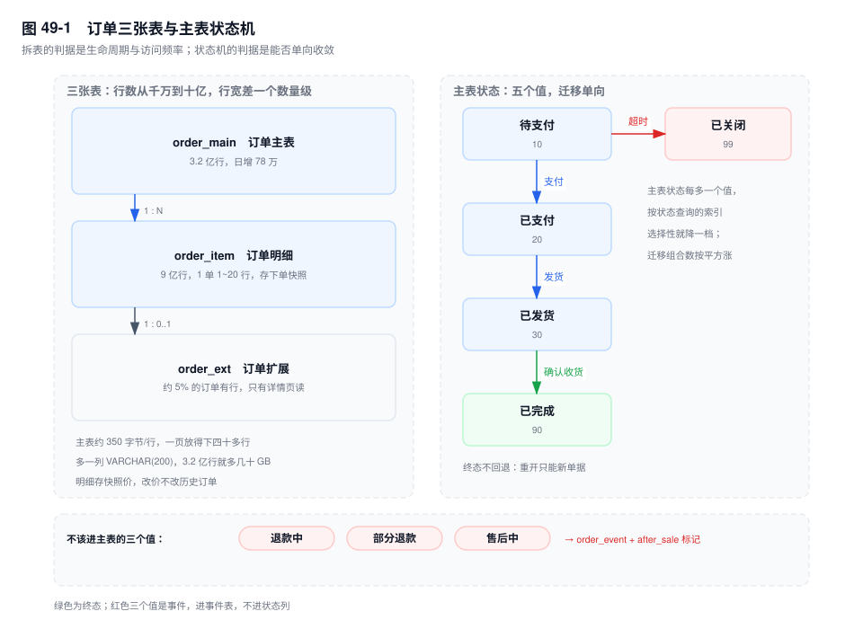
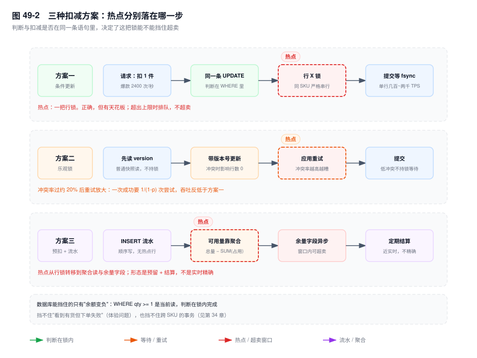
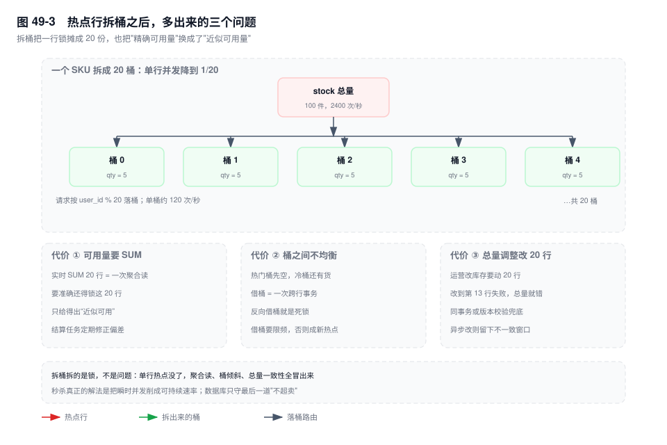

# 第 49 章　业务模型实战（上）：交易与库存

> **一句话结论**：并发安全不能靠"先查再改"，只能靠"让数据库在一次操作里既判又改"；表上的每一条约束，都要能回答"它挡住了哪一种错误"。

## 49.0 场景：大促当天超卖了 37 件

零点开抢，第十一分钟，爆款 SKU 的可用库存显示 -37。

不是少卖了 37 件，是 37 个订单都扣成功了——每一单都以为自己拿到了最后一件。复盘会上，扣减语句被投到大屏：

```sql
UPDATE stock SET qty = qty - 1 WHERE sku_id = 8842;
```

没有 `AND qty >= 1`。这条 SQL 从不判断够不够，它只负责减。判断在应用层，代码长这样：

```sql
SELECT qty FROM stock WHERE sku_id = 8842;   -- 读到 1，判断"够"
-- 应用层 if (qty >= 1)
UPDATE stock SET qty = qty - 1 WHERE sku_id = 8842;
```

两条语句之间有一个窗口。窗口里并发进来的请求，读到的是同一个 1。`SELECT` 是快照读、不加锁（见第 17 章），所以它们谁也看不见谁；`UPDATE` 是无条件减，所以谁也拦不住谁。37 这个数字，就是库存剩 1 的那一瞬间同时到达的请求数。

37 不是运气差，是并发窗口宽度的函数：窗口越宽、并发越高，数字越大。把判断挪进 `WHERE`，同样的流量下这个数字是 0，代价只是排队。

三句话在这三行代码里已经写完了：数据库不会替你判断，没有 `WHERE` 就没有判断；应用层的判断在并发下无效，读和写之间没有锁；能救的只有一种写法——把判断塞进同一条语句，让它和修改共享同一把锁。

后面九节都在展开这一件事：交易系统里的每一张表、每一个字段、每一条索引，究竟挡住了哪一种错误。

## 49.1 订单的三张表：拆分的判据不是"字段太多"

一张表拆不拆，不看列数，看两件事：这些列的生命周期是否与主表一致，访问频率是否与主表同一量级。

示例系统的三张表：`order_main` 3.2 亿行、日增 78 万；`order_item` 9 亿行；`order_ext` 只有约 5% 的订单有行。行数从千万到十亿，行宽差一个数量级——这是它们该分开的第一个信号。

**账要按页算，不是按字节。** 主表压到 350 字节一行，16KB 的页放得下四十多行；加一列 `VARCHAR(200)`，平均 100 字节，每页掉到三十多行，同样的 3.2 亿行要多占三成页面，Buffer Pool 能装下的行数直接少三成。按字节算也直观：3.2 亿 × 100 字节 = 32GB，为一个 95% 的订单都用不上的字段付这笔钱。

扩展表装的是发票信息、预约配送时间窗、企业抬头这类字段。判据不是"它大"，是"只有 5% 的行有值，且只有详情页和开票流程会读"。放进主表，等于给 95% 的行收税。

明细表必须独立的理由更硬：一单多行，塞进主表只能是 JSON 数组——没法按 `sku_id` 统计销量，没法建索引，也没法单独改某一行的数量。拆出来之后，`UNIQUE KEY uk_order_line (order_id, line_no)` 挡住了"同一次重试把同一行明细插两遍"。

明细里的 `sku_name`、`unit_price` **必须是下单时刻的快照**，这是反范式，但方向与"冗余总额"相反：商品改名、调价之后，历史订单显示的金额和名称不能跟着变。判断依据是这一列表示的是"当时的事实"还是"当前的状态"（见第 31 章）。

**状态要收敛且单向。** 五个值够用：`10 待支付 / 20 已支付 / 30 已发货 / 90 已完成 / 99 已关闭`。退款中、部分退款、售后中都不该进这一列。原因有两条，都能量化：

- 选择性。3.2 亿行里"退款中"即使占 3%，按它查仍要回表近 1 亿行，索引帮不上；而这 1 亿行会挤掉别的状态本该命中的缓存页。
- 组合数。5 个状态最多 20 条边，代码里 20 个判断；12 个状态理论上有 132 条边，每一对都要判断能不能走，还得判断谁先谁后。

正确形态是：退款、售后作为**事件**写进 `order_event`，主表只留一个 `after_sale TINYINT` 标记（0 无、1 有进行中售后），列表页只读这个标记。

**订单号不能做主键。** 第 30 章的结论可以直接搬：业务编号会变（加渠道前缀、纠错改号），改主键等于聚簇索引重排加每个二级索引删旧插新；而且 20~32 字节的字符串会被每一个二级索引复制一遍。做法是 `id BIGINT UNSIGNED AUTO_INCREMENT` 做主键，`order_no` 只做唯一索引。分库分表之后自增不可用（见第 33 章），那时才换雪花或号段——选型时顺序性优先于"好看"，因为落点决定页分裂和页 latch 争用。

**金额用 `DECIMAL(18,2)`**，9 字节、精确。`DOUBLE` 是 8 字节，但 0.1 无法精确表示，累加百万行之后误差是分级别的，对账时会被当成"账错了"。

主表还要冗余一个 `pay_amount`（应付总额）。列表页 20 单、对账、风控都要"这单多少钱"，每次去 `SUM(order_item)` 意味着 20 次回表 × 20 单 = 400 行读。这是反范式，代价写清楚：明细变更必须同步主表，同库用同事务，跨库用对账兜（见第 31 章、第 34 章）。

```sql
CREATE TABLE order_main (
  id           BIGINT UNSIGNED NOT NULL AUTO_INCREMENT,
  order_no     CHAR(22)        NOT NULL,
  merchant_id  BIGINT UNSIGNED NOT NULL,
  buyer_id     BIGINT UNSIGNED NOT NULL,
  status       TINYINT         NOT NULL DEFAULT 10,
  after_sale   TINYINT         NOT NULL DEFAULT 0,
  pay_amount   DECIMAL(18,2)   NOT NULL DEFAULT 0.00,
  created_at   DATETIME(3)     NOT NULL DEFAULT CURRENT_TIMESTAMP(3),
  paid_at      DATETIME(3)     DEFAULT NULL,
  PRIMARY KEY (id),
  UNIQUE KEY uk_order_no (order_no),
  KEY idx_buyer_created (buyer_id, created_at),
  KEY idx_status_created (status, created_at)
) ENGINE=InnoDB;
```

`UNIQUE KEY uk_order_no` 挡重复订单号，`idx_status_created` 支撑"按状态扫一段时间"的运营查询，`after_sale` 挡住"为了查售后状态去 join 事件表"。



## 49.2 库存扣减：三种方案的并发上限，以及各自漏在哪一步

**方案一：条件更新。**

```sql
UPDATE stock
SET qty = qty - 1, version = version + 1
WHERE sku_id = 8842 AND warehouse_id = 3 AND qty >= 1;
```

`affected_rows = 0` 就是没货，不需要再查一次。判断与修改在同一把行 X 锁里完成：`WHERE` 走的是当前读，读到的是最新已提交版本，不是事务开始时的快照（见第 1 章、第 17 章）。这是它不超卖的全部原因——判断发生在锁内，锁外的请求只能排队。

锁的形态取决于索引。主键是 `(sku_id, warehouse_id)` 时，等值条件填满唯一键，锁退化成一条记录锁（见第 19 章）。如果只在 `sku_id` 上建普通索引，一次扣减会锁住这个 SKU 在所有仓库的行，外加右边一段间隙：不同仓库互相排队，新 SKU 插不进来。

并发上限由单行锁的持有时间决定。一次这样的 `UPDATE` 在 NVMe 上，定位加改行加写 undo，行锁本身在百微秒量级，理论上单行能撑几千 TPS；但锁要持有到 `COMMIT`，而每次提交还要等 redo `fsync`（`innodb_flush_log_at_trx_commit=1`，见第 4 章），一次 `fsync` 在 NVMe 上是几十到几百微秒，再叠上组提交排队。所以同一行的实际吞吐落在每秒几百到两千这个区间。爆款 SKU 2400 次/秒，已经越过这条线：不超卖，但锁等待队列会变长，P99 从毫秒级爬到秒级。**正确，但有天花板，而且天花板的成因与 CPU、连接数都无关，只与"同一行有多串行"有关。**

**方案二：乐观锁。**

```sql
UPDATE stock
SET qty = qty - 1, version = version + 1
WHERE sku_id = 8842 AND warehouse_id = 3 AND version = 31;
```

冲突时 `affected_rows = 0`，应用重读取 version 再试。低冲突时它比方案一好：读 version 是普通快照读、不持锁，只在这条 `UPDATE` 的瞬间持锁，不需要在"读—算—写"之间跨一次网络往返持锁（方案一若拆成 `SELECT ... FOR UPDATE` 再 `UPDATE` 就要）。

高冲突时它更差。设冲突率为 p，一次成功平均要 1/(1−p) 次尝试：p = 20% 是 1.25 次，p = 50% 是 2 次，p = 80% 是 5 次。每次失败都要做一次索引定位、加锁、判断，全是白干的活，还占着连接和 CPU。**判据是同一个 SKU 的并发度，不是总 QPS。** 全站 3.2 万 QPS 摊到 20 万 SKU，单 SKU 并发不到 1，方案二几乎不冲突；爆款 2400 次/秒全压在一个 SKU 上，冲突率接近 100%，重试风暴的吞吐低于方案一。

**方案三：预扣加流水。**

```sql
INSERT INTO stock_flow (sku_id, biz_no, direction, qty, status)
VALUES (8842, 'SO20261111000871', 1, 1, 'RESERVED');
```

把扣减变成插入。流水表用自增主键时，插入落在尾部、顺序写，没有"同一行被反复改"的热点。可用量 = 总量 − `SUM(有效占用)`。三个漏点：

- **余量字段异步维护，就有窗口。** 窗口内多个请求都看到"够"，超卖正是在这里漏的。
- **每次 `SUM`，就把热点搬到了读路径。** 单 SKU 的流水越积越多，2400 次/秒的插入让扫描量线性增长；RR 下还要沿版本链判断可见性，退化成慢查询。
- **要准确就得锁。** `SUM` 加 `FOR UPDATE` 才挡得住并发插入，一锁就回到串行，而且锁的是整个 SKU 的流水范围，比方案一锁得更宽。

所以它的正确形态是"预留 + 定期结算"：实时只做插入和一次粗余量判断（宁可少卖），结算任务把流水汇总成余量、修正偏差。换来的是吞吐，不是精确。

| 方案 | 能否超卖 | 单行并发上限 | 失败重试成本 | 对账复杂度 |
|---|---|---|---|---|
| 条件更新 | 不会，判断在锁内 | 每秒几百到两千 | 无重试，直接返回无货 | 低 |
| 乐观锁 | 不会 | 低冲突高于方案一，高冲突低于 | 冲突率 p 时 1/(1−p) 次 | 低 |
| 预扣 + 流水 | 会，余量异步时有窗口 | 插入无单行上限，卡在聚合读 | 无需重试，但可能事后回滚 | 高，流水与余量双向对账 |

**超卖究竟在哪一步被挡住。** 数据库能挡的只有"余额变成负数"：`WHERE qty >= 1` 挡的是最后一件被两个人同时拿走。它挡不住三件事，分清它们才好安排责任：

- **看到有货、下单却失败** —— 体验问题，解法是前端限流和预估库存，不是数据库。
- **跨 SKU 的原子性** —— 一单扣 5 个 SKU，第 5 个失败要回滚前 4 个，这是事务边界与加锁顺序问题（见第 20 章、第 34 章）。
- **扣了但订单没建出来** —— 同库靠回滚，跨库只能靠对账。

还该加一道兜底：`CHECK (qty >= 0)` 在 8.0.16 起才真正生效，违反时报 `ERROR 3819 (HY000): Check constraint 'ck_qty' is violated.`。它挡不住并发（并发靠 `WHERE`），但能挡住 49.0 里那种漏写条件的 SQL 把负数写进表——如果当时有这条约束，那 37 单会直接报错回滚，库存停在 0。



## 49.3 秒杀：把一行拆成 N 行之后，问题变成了另一个

爆款 SKU 单行 2400 次/秒撑不住，最直接的办法是拆：

```sql
CREATE TABLE stock_bucket (
  sku_id    BIGINT UNSIGNED  NOT NULL,
  bucket_no TINYINT UNSIGNED NOT NULL,
  qty       INT              NOT NULL,
  PRIMARY KEY (sku_id, bucket_no),
  CONSTRAINT ck_bucket_qty CHECK (qty >= 0)
) ENGINE=InnoDB;
```

总量 100 拆 20 行、每行 5，请求按 `bucket_no = buyer_id % 20` 落桶。单桶并发降到 120 次/秒，远低于单行的上限。收益是确定的，代价也是确定的，一共三个。

**代价一：可用量判断要 `SUM`，而 `SUM` 不能实时。** `PRIMARY KEY (sku_id, bucket_no)` 让同一 SKU 的 20 行在主键上连续，`SUM` 是 20 行、通常 1~2 个页的范围扫描，比单行贵 20 倍但仍在毫秒内。问题不在快，在准：要准确就得把这 20 行都锁住，一次扣减锁 20 行，锁范围反而变大；不锁就只能给出"近似可用"，前端显示有货、落桶失败。

**代价二：桶之间不均衡。** 买家 ID 取模在统计上均匀，但"成功的扣减"不均匀：某个桶先空，后续落在这个桶的请求全部失败，别的桶还压着货。解法是借桶——从相邻桶搬一件过来，一次跨两行的事务；两笔借桶方向相反就是死锁（见第 20 章、第 41 章案例六）。所以借桶必须按 `bucket_no` 排序，并且限频，否则借桶本身变成新的热点。

**代价三：总量调整要改 20 行。** 运营把 100 改成 120，20 行各加 1；改到第 13 行失败，总量就是 113。要么同事务（20 行锁，和扣减抢同一批行），要么异步（留下不一致窗口，还得靠对账修）。这一条最容易被忽略，因为它只在大促前调库存时才发生。

**异步落库的边界。** MQ 削峰之后，落库失败是常态而不是异常。关键判断是"哪一步算成功"：把"进队列"当成功，就必须有结果通知和失败退款；把"落库成功"当成功，就要接受大量请求在队列里空等。两种都能做，假装成功不能做——"页面显示抢到了，实际没扣上，也不退款"是这类系统最常见的事故。

**为什么要限流，而不是排队。** `L = λW`（见第 36 章）是恒等式：队列长度 L 有上限时，λ 越大 W 越长；W 超过客户端超时（比如 3 秒），客户端重试，λ 又变大，W 更长。拒绝是常数成本，排队是指数成本。所以入口要的是"有界队列 + 快速失败"，不是"无限排队 + 事后补偿"。

一句话收尾：**秒杀的本质不是数据库问题，是把瞬时并发削成可持续速率的问题；数据库能做的只有守住最后一道不超卖。**



## 49.4 账户余额与流水：对账必须是双向的

```sql
UPDATE account SET balance = balance - 100.00 WHERE account_id = 77001 AND balance >= 100.00;
```

与库存同构，判断同样在锁内。账户多一条硬约束：**每一分钱的变化都必须有流水**，所以正确形态是同一事务里改余额、插流水，两者要么都在，要么都不在。

`account_flow` 的唯一索引 `(account_id, biz_no, direction)` 是幂等的硬保证：同一笔业务重复回调，第二次插入撞 1062，整个事务回滚，余额不会被扣两次。`biz_no` 用上游的支付单号或结算单号，不用自增——它必须能被外部系统对上。

对账有两个方向，缺一不可：

- **流水汇总 = 余额。** `SELECT SUM(amount) FROM account_flow WHERE account_id = ?` 与 `account.balance` 比。它能发现"改了余额没记流水"和"记了流水没改余额"。
- **余额快照 vs 流水增量。** 每天切一张 `account_snapshot(account_id, snap_date, balance)`，用 T-1 快照加当日流水增量推出今天的应有余额，与实际余额比。它能发现"历史某一段被改过"——某天的余额被手工改过，之后一直沿用，方向一每天都是平的。

只做一个方向会漏什么：只做方向一，"两边一起错"永远通过。有人手工 `UPDATE balance` 又补了一条流水，方向一平；再叠方向二，只要这笔修改发生在两次快照之间、且流水也补了，方向二同样平。这种"按同一个错误改两边"的情况，只能靠和上游单据三方勾对（订单金额、支付流水、账户流水）发现。所以双向对账是底线，不是终点。差异跑出来之后还要能定位到具体一笔：流水上的 `biz_no` 唯一，两侧都能追回订单号，否则对账只是告诉你"错了"，给不出下一步。

**余额的热点与库存不同。** 一个商户的结算账户在结算日会被反复更新，同一行排队。库存可以拆桶，余额不能——余额是守恒量，拆开之后"哪个桶扣"没有业务含义，合并又要跨行事务。可行的只有串行化加异步：把同一账户在一个时间窗（比如 200ms）内的 N 次变动合并成一次 `UPDATE account SET balance = balance - ?`。

这里有个容易做错的地方：**合并的是余额更新，不是流水。** 流水必须逐笔，因为对账要按 `biz_no` 勾对；余额只是流水的结果，可以用任意方式算出来，只要最终相等。反过来做（合并流水、逐笔改余额）等于把可审计性丢了。

## 49.5 幂等：三层防线里只有一层是硬的

- **唯一索引**：数据库层面不可能重复。硬保证。
- **状态机**：`UPDATE order_main SET status = 20, paid_at = NOW(3) WHERE id = ? AND status = 10`，`affected_rows = 0` 即重复。次硬，依赖状态单向。
- **去重表 / Redis**：软保证。进程重启丢内存标记、主从切换丢最后一段、key 过期早于重试窗口，三种情况都会失效。

状态机这一层还有个前提：状态必须由这一条 `UPDATE` 独占推进。如果同一状态有两个入口都能改（支付回调和人工补单），`affected_rows = 0` 只能说明"别人先改了"，不能说明"这一笔重复了"。

**只有唯一索引不可绕过。** 前两层失效时，重复请求会真的打到数据库；如果数据库没有唯一约束，就真的重复了。所以幂等键必须落成一个真实的唯一索引，而不是只存在 Redis 里。

订单场景的键是 `(merchant_id, out_trade_no)`：商户号加商户侧订单号，天然唯一，且由外部提供，不依赖本系统发号。

```sql
-- 1) 先加可空列：唯一索引里多个 NULL 互不相等，回填期间不会互相冲突
ALTER TABLE order_main ADD COLUMN out_trade_no VARCHAR(64) NULL;

-- 2) 从各渠道导出历史单号，按主键分批回填
UPDATE order_main SET out_trade_no = ? WHERE id = ?;

-- 3) 回填干净之后再收紧、再建唯一键（这一步重建表，走 gh-ost 或留窗口）
ALTER TABLE order_main
  MODIFY out_trade_no VARCHAR(64) NOT NULL,
  ADD UNIQUE KEY uk_merchant_out (merchant_id, out_trade_no);
```

顺序不能反。用 `NOT NULL DEFAULT ''` 直接加唯一键，3.2 亿行的空串会在同一商户下互相冲突，`ALTER` 当场报 1062；用 `NULL` 过渡，唯一索引只约束有值的行，回填到哪一步就约束到哪一步。

重复插入报 `ERROR 1062 (23000): Duplicate entry '1001-20260811000871' for key 'order_main.uk_merchant_out'`，捕获后按这个键查出原订单返回。两个细节必须知道：

- 1062 之后，InnoDB 会对冲突记录加一把 `S` 锁并持有到事务结束（见第 19 章）。所以在同一个事务里捕获异常、接着又去改这一行，很容易和自己或别人交叉等待。正确做法是回滚当前事务，另开一个事务查原订单。
- `INSERT ... ON DUPLICATE KEY UPDATE` 能避开 `S` 锁升级，但它会真的执行更新，`affected_rows` 变成 2，用它做幂等要小心把"重复"当成"更新成功"。

三层是纵深，不是替代：唯一索引兜底，状态机挡住绝大多数重复，Redis 减少无效请求。任何一层被当成唯一防线，都会在它失效的那天出事。

## 49.6 关键结论

1. **并发安全只有一种写法：判断与修改在同一条语句里。** `WHERE qty >= 1` 有效，是因为它执行当前读、在行锁内判断；应用层 `SELECT` 之后的 `if` 在并发下等于没写。
2. **表结构是按"错误"设计的，不是按"字段"设计的。** 唯一索引挡重复、`CHECK` 挡非法值、状态列挡非法迁移、冗余总额挡聚合读——每条都要说得出它挡的是哪个错。
3. **库存三种方案不是好坏，是上限不同。** 条件更新守住正确性、单行几百到两千；乐观锁把等待换成重试，冲突率一过两成就反转；预扣流水把热点搬到聚合读，用精确换吞吐。
4. **拆桶拆的是锁，不是问题。** 拆完得到三个新问题：`SUM` 不实时、桶不均衡要借桶、总量调整要改 N 行；数据库只守"不超卖"这一道。
5. **账户与库存同构，但多一条硬约束：每一分钱都要有流水。** 余额可以合并更新，流水必须逐笔；对账要双向，双向都过还要和上游单据勾对。
6. **幂等的三层防线里，只有唯一索引不可绕过。** 幂等键必须落成真实的唯一索引；存在 Redis 里的键只是减少了请求，不是保证。

## 49.7 实验验证

### 实验一：并发扣减验证不超卖

```sql
CREATE DATABASE IF NOT EXISTS lab49;
USE lab49;

CREATE TABLE stock (
  sku_id       BIGINT UNSIGNED  NOT NULL,
  warehouse_id INT UNSIGNED     NOT NULL,
  qty          INT              NOT NULL,
  version      INT UNSIGNED     NOT NULL DEFAULT 0,
  PRIMARY KEY (sku_id, warehouse_id),
  CONSTRAINT ck_qty CHECK (qty >= 0)
) ENGINE=InnoDB;

INSERT INTO stock VALUES (8842, 3, 1, 0);
```

```sql
-- 会话 A
BEGIN;
UPDATE stock SET qty = qty - 1 WHERE sku_id = 8842 AND warehouse_id = 3 AND qty >= 1;
-- 不要提交

-- 会话 B（另一个连接）
BEGIN;
UPDATE stock SET qty = qty - 1 WHERE sku_id = 8842 AND warehouse_id = 3 AND qty >= 1;
-- 阻塞，停在 Waiting for ... lock

-- 回到会话 A
COMMIT;

-- 会话 B 此时返回，再看结果
SELECT qty FROM stock WHERE sku_id = 8842 AND warehouse_id = 3;
```

```text
# 输出形态（未实跑，字段含义以此为准）
会话 A: Query OK, 1 row affected        -- 扣到 0
会话 B: Query OK, 0 rows affected       -- 等到了锁，但 WHERE 不满足
qty: 0
```

第三个人再来一次，同样 0 行。**B 的 0 行不是"没找到"，是"判断在锁内做了、结论是不许扣"。** 把 `AND qty >= 1` 去掉重跑，A、B 都会返回 1 行：没有 `CHECK` 时 `qty` 变成 -1，有 `CHECK` 时第二条报 3819。两种都是超卖，一种写进了数据，一种写成了报错——后者至少看得见。

### 实验二：乐观锁冲突时的影响行数

```sql
-- 复位，避免实验一留下的 qty = 0 撞上 CHECK
UPDATE stock SET qty = 1, version = 0 WHERE sku_id = 8842 AND warehouse_id = 3;

-- 会话 A
BEGIN;
UPDATE stock SET qty = qty - 1, version = version + 1
WHERE sku_id = 8842 AND warehouse_id = 3 AND version = 0;
SELECT ROW_COUNT();

-- 会话 B
BEGIN;
UPDATE stock SET qty = qty - 1, version = version + 1
WHERE sku_id = 8842 AND warehouse_id = 3 AND version = 0;
SELECT ROW_COUNT();
```

```text
# 输出形态（未实跑，字段含义以此为准）
会话 A: ROW_COUNT() = 1      -- version 0 -> 1
会话 B: ROW_COUNT() = 0      -- 阻塞到 A 提交后，version 已是 1，条件不成立
```

`ROW_COUNT()` 是乐观锁的唯一判据，不要用 `SELECT` 反查——反查会把"没抢到"和"没这行"混在一起。

### 实验三：桶化库存的 SUM 与单行对比

```sql
CREATE TABLE stock_bucket (
  sku_id    BIGINT UNSIGNED  NOT NULL,
  bucket_no TINYINT UNSIGNED NOT NULL,
  qty       INT              NOT NULL,
  PRIMARY KEY (sku_id, bucket_no)
) ENGINE=InnoDB;

-- 20 行，每行 qty = 5
SELECT SUM(qty) AS avail FROM stock_bucket WHERE sku_id = 8842;

EXPLAIN SELECT SUM(qty) FROM stock_bucket WHERE sku_id = 8842;
EXPLAIN SELECT qty FROM stock_bucket WHERE sku_id = 8842 AND bucket_no = 7;
```

```text
# 输出形态（未实跑，字段含义以此为准）
avail: 100
SUM 的 EXPLAIN: type=range, key=PRIMARY, rows=20, Extra="Using index"
单桶的 EXPLAIN: type=const, key=PRIMARY, rows=1
```

两次都走主键、都用覆盖索引，差别只在行数 20 与 1。**这说明拆桶的代价不在 IO，在"必须读 20 行才能回答够不够"，以及要准确就得把这 20 行一起锁住。**

### 实验四：幂等唯一索引报 1062

```sql
INSERT INTO order_main (order_no, merchant_id, buyer_id, out_trade_no, pay_amount)
VALUES ('SO20261111000871', 1001, 8842, '20261111000871', 199.00);

INSERT INTO order_main (order_no, merchant_id, buyer_id, out_trade_no, pay_amount)
VALUES ('SO20261111000872', 1001, 8842, '20261111000871', 199.00);
```

```text
# 输出形态（未实跑，字段含义以此为准）
第 1 条: Query OK, 1 row affected
第 2 条: ERROR 1062 (23000): Duplicate entry '1001-20261111000871'
        for key 'order_main.uk_merchant_out'
```

注意第二条换了 `order_no` 仍然失败——挡住它的是 `uk_merchant_out`，不是 `uk_order_no`。错误信息里带索引名，这是判断"撞的是哪个唯一键"的最快依据。

## 49.8 常见误区

⚠️ **"先 `SELECT` 判断再 `UPDATE` 就够了"**
判断与修改之间有一个窗口，窗口里所有并发请求读到同一个值。`SELECT` 是快照读、不加锁，所以这个窗口不是微秒级，是整个业务逻辑的执行时间。要修只有两条路：把判断写进 `UPDATE` 的 `WHERE`（当前读，锁内判断），或者 `SELECT ... FOR UPDATE` 把窗口用锁封起来——后者把网络往返也放进了锁里，代价更大。

⚠️ **"乐观锁一定比悲观锁快"**
只在低冲突时成立。冲突率 p 决定重试次数 1/(1−p)：p 到 20% 时每五次尝试就有一次白干，p 到 80% 时平均要试五次。乐观锁优化的是"等待"，不是"总工作量"；冲突高时总工作量反而更大。判据是同一行的并发度，不是系统总 QPS。

⚠️ **"库存拆桶就解决了秒杀"**
拆桶只把单行锁的争用摊薄 1/N，同时引入三个新问题：可用量要聚合、桶不均衡要借桶、总量调整要改 N 行。真正的瓶颈通常在入口流量和下游落库，单靠拆桶会把"锁等待"换成"聚合读 + 借桶死锁 + 不一致窗口"。

⚠️ **"有了 Redis 去重就不用唯一索引"**
Redis 的键会丢：重启、主从切换、过期早于重试窗口、集群迁移。丢的那一刻，重复请求会全部打到数据库，而数据库没有任何约束拦它。Redis 只能减少无效请求，唯一索引才是那道不可绕过的墙。

⚠️ **"订单号做主键更直观"**
直观的代价是每次改号都要重排聚簇索引、重建每个二级索引里的条目、让所有外部引用失效；平时看不出来，因为订单号几乎不变。真正的问题是"会变"这件事一旦发生，代价与表体积成正比。自增主键加唯一索引，把这件事降级成一次普通 `UPDATE`。

## 49.9 生产 Checklist：交易表设计的 12 项

- [ ] 主键是 `BIGINT UNSIGNED AUTO_INCREMENT`（或雪花/号段），业务单号只做唯一索引，不做聚簇主键
- [ ] 金额列是 `DECIMAL(18,2)`，没有 `FLOAT` / `DOUBLE`；币种单独一列，不混在金额里
- [ ] 主表状态列的取值不超过 6 个，且迁移单向；退款、售后是事件表，主表只有一个 `after_sale` 标记
- [ ] 状态迁移用 `UPDATE ... WHERE status = 旧值`，并检查 `affected_rows`，不先查后改
- [ ] 库存扣减的 `WHERE` 里有 `qty >= n`，且 `(sku_id, warehouse_id)` 上有唯一键，锁退化成记录锁
- [ ] 库存表有 `CHECK (qty >= 0)`（8.0.16+ 生效），作为漏写条件的兜底
- [ ] 明细表有 `UNIQUE (order_id, line_no)`，明细里的商品名与单价是下单快照，不是 join 当前值
- [ ] 主表冗余的汇总金额（`pay_amount`）有明确的同步路径：同事务写，或对账任务修
- [ ] 幂等键落成真实唯一索引（如 `(merchant_id, out_trade_no)`），捕获 1062 后回滚再查，不在原事务里继续写
- [ ] `account_flow`、`stock_flow` 有 `(account_id, biz_no, direction)` 这类唯一键，同一笔业务不能记两次
- [ ] 对账有两个方向：流水汇总对余额、快照加增量对余额；两个方向都过之后还有上游单据勾对
- [ ] 批量扣减多个 SKU 时按 `sku_id` 排序后再逐条更新，重试走同一套排序（见第 20 章、第 41 章案例六）

## 49.10 延伸

- **关联章节**：第 19 章（加锁范围决定扣减的并发上限）、第 20 章（多 SKU 扣减的加锁顺序）、第 30 章（为什么订单号不做主键）、第 31 章（范式、反范式与状态字段）、第 34 章（跨库扣减与 TCC、本地消息表）、第 41 章案例六（死锁风暴）。
- **下一章**：第 50 章会把同样的推导用到内容、计数与队列上——`UPDATE count = count + 1` 的热点、分桶计数、以及为什么用 MySQL 做队列要慎用。
- **面试追问**：
  - "`UPDATE ... WHERE qty >= 1` 为什么不会超卖，而先 `SELECT` 再 `UPDATE` 会？" → 前者是当前读 + 行锁内判断，判断与修改原子；后者中间有窗口，快照读不加锁，并发请求读到同一个值。
  - "乐观锁和悲观锁在什么冲突率下会反转？" → 冲突率 p 时一次成功要 1/(1−p) 次尝试，两成时多花的尝试已经接近方案一排队的成本，再高就是重试风暴；判据是同一行的并发度，不是总 QPS。
  - "库存拆成 20 个桶之后，还剩哪些问题？" → 可用量要 `SUM` 且不实时、桶不均衡要借桶（跨行事务、可能死锁）、总量调整要改 20 行；秒杀的本质是削峰，拆桶只是削锁。
- **官方文档**：`InnoDB Locking and Transaction Model`、`Locks Set by Different SQL Statements in InnoDB`、`CREATE TABLE ... CHECK Constraints`（8.0.16 起生效）、`Server Error Message Reference`（1062 / 3819 / 1213）。
