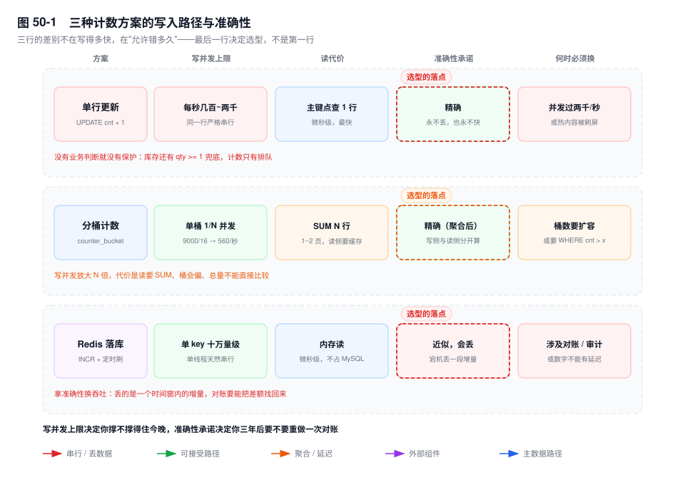
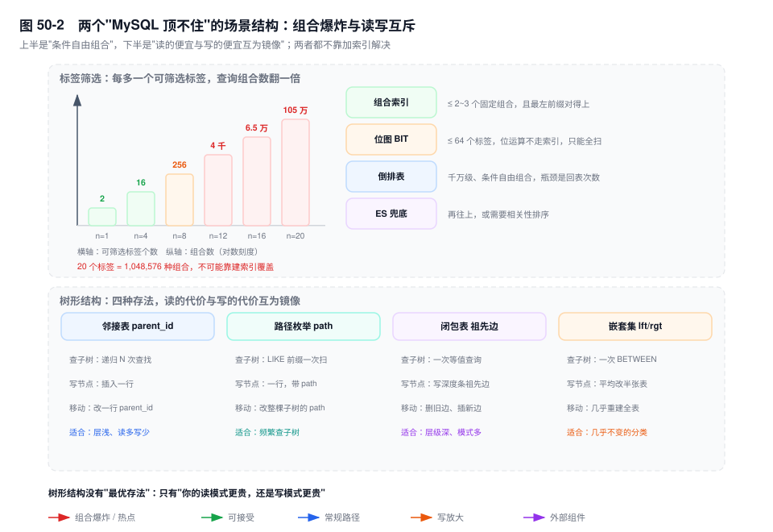

# 第 50 章　业务模型实战（下）：内容、计数与队列

> **一句话结论**：这些场景的瓶颈不是 IO 也不是 CPU，是"同一行的串行"；MySQL 能在这里顶多久，取决于你允许它错多久，而不是它跑得多快。

## 50.0 场景：一条 `UPDATE ... SET cnt = cnt + 1` 把 3 万 QPS 打成 900

内容团队上线了"评论数实时显示"，实现是一行：

```sql
UPDATE content_post SET comment_cnt = comment_cnt + 1 WHERE id = 10086;
```

一条吐槽爆了。晚八点，这条内容的互动从每秒两百涨到九千，`Threads_running` 从 8 冲到 190，同一实例上订单查询的 P99 从 40ms 变成 2.1 秒，整实例的 QPS 从 3.2 万掉到 900。订单侧没有人改代码，也没有多下一单。

这条 SQL 本身不慢。`EXPLAIN` 是 `const`，一行，主键，零回表。慢的是它后面排的队：同一个 `id` 的九千次更新严格串行，每一次都要等前一个事务提交；排队的事务各占一个连接线程，线程数远超 16 核，CPU 大量时间花在锁唤醒和上下文切换上；被反复更新的那一页还要来回抢页 latch，同一页上的其它记录跟着一起慢。

于是故障的形态是：**一个热点行的排队，惩罚了同一实例上的所有业务。它不是"这条 SQL 慢"，是"这个实例慢"。**

后面六节是同一结构的六个变种：写多读少，且写集中在极少数行或组合上，冲突点在锁队列里，不在页上也不在 IO 上。

## 50.1 计数：三种拆法的代价各是什么

**单行更新。** 上限与第 49 章的库存扣减同量级：每秒几百到两千。两者的差别不在速度，在有没有判断。库存有 `WHERE qty >= 1`，越界时 `affected_rows = 0`，错误被挡在锁里；计数没有任何业务判断，`cnt + 1` 永远成立，所以它**不会算错，只会算不进去**。九千次每秒是上限的四五倍，多出来的请求全部堆在锁等待队列里；队列不丢请求，只是把 P99 从毫秒推到秒，客户端超时重试再放大一轮（见第 36 章）。

**分桶计数。** 把一行拆成 N 行，写并发放大 N 倍：

```sql
CREATE TABLE counter_bucket (
  biz_type  TINYINT UNSIGNED  NOT NULL,
  biz_id    BIGINT UNSIGNED   NOT NULL,
  bucket_no TINYINT UNSIGNED  NOT NULL,
  cnt       BIGINT UNSIGNED   NOT NULL DEFAULT 0,
  PRIMARY KEY (biz_type, biz_id, bucket_no)
) ENGINE=InnoDB;

INSERT INTO counter_bucket (biz_type, biz_id, bucket_no, cnt)
VALUES (1, 10086, 7, 1)
ON DUPLICATE KEY UPDATE cnt = cnt + 1;
```

9000 次/秒摊到 16 个桶，单桶不到 600 次/秒，压回了单行上限之内。三个代价：

- **读要聚合。** `SELECT SUM(cnt) ... WHERE biz_type=1 AND biz_id=10086` 是同一主键前缀上的 16 行，1~2 个页，覆盖索引，百微秒内。但热点内容的计数会被读 3.2 万次每秒，`SUM` 再快也架不住这个频次，聚合值还得再套一层缓存——缓存一上，"精确"就又打了一次折。
- **桶不均衡。** 按访客 ID 取模在总量上均匀，在时间上不均匀。要更均匀就随机落桶，代价是丢掉"某个访客点没点过"的可查性——计数本来也不查这个。
- **总量无法直接过滤。** `WHERE cnt > 1000` 得写成 `GROUP BY biz_id HAVING SUM(cnt) > 1000`，等于全表聚合，索引完全用不上。另外桶数是表结构的一部分，扩容要搬数据。

**Redis 加定期落库。** 写走 `INCR cnt:post:10086`，单线程模型天然串行，单 key 十万量级；每分钟把"当前值减上次落库值"的增量刷回 MySQL。三个代价：**宕机丢增量**（`appendfsync everysec` 仍可能丢最后一秒的写）、**对账复杂**（两侧不一致时只能以一侧为准整体重刷，而那一侧也可能已经错过）、**有延迟**（延迟窗口内用户看到的是近似值，"点完刷新看不到 +1"要单独做体验兜底）。

判据只有一句：**允许短暂不准就用 Redis；必须精确且并发不高就用单行；必须精确且并发高就分桶加异步合并。** 三者不是演进关系，是三种不同的准确性承诺——先决定你要哪一种，再谈性能。



## 50.2 Feed：推与拉之间只有一条判据

**推模式（写扩散）**：发一条内容，给每个粉丝的收件箱插一行。

```sql
CREATE TABLE content_feed (
  user_id    BIGINT UNSIGNED NOT NULL,
  created_at DATETIME(3)     NOT NULL,
  post_id    BIGINT UNSIGNED NOT NULL,
  author_id  BIGINT UNSIGNED NOT NULL,
  PRIMARY KEY (user_id, created_at, post_id)
) ENGINE=InnoDB;
```

主键顺序是这个设计的全部：`(user_id, created_at, post_id)` 让"我的最新 20 条"变成主键上一次反向范围扫，扫满 20 行就停，不排序、不回表。`post_id` 排在最后，是为了同一毫秒发的两条内容有确定顺序——`DATETIME(3)` 在批量发布时撞毫秒是常事。写 O(粉丝数)，读 O(1)。

**拉模式（读扩散）**：只存内容表，读的时候现拼：

```sql
SELECT post_id FROM content_post
WHERE author_id IN (101, 205, 887, ...)   -- 关注了 N 个人
ORDER BY created_at DESC LIMIT 20;
```

写 O(1)，读 O(N 路归并)。这里有个容易被 `LIMIT 20` 骗过去的地方：`IN` 列表加 `ORDER BY` 加 `LIMIT` 凑在一起时，优化器要按 `(author_id, created_at)` 把 N 个区间全扫出来再排序，`LIMIT` 在排序之后才生效（见第 14 章）。500 个关注、每人每月 300 条，排序输入就是 15 万行。改成 500 个 `UNION ALL` 各取 20 条再归并，扫描量压到 1 万行，代价是 500 次子查询的解析开销。

**关键数字。** 一个 100 万粉丝的账号发一条，推模式要写 100 万行、约 40MB。这不是"慢"，是"不可能"——卡点不在插入本身，在复制：一个事务写 100 万行，binlog 事件巨大，从库回放时无法并行（第 25 章的并行复制以库或事务为单位），延迟会在这几十秒里持续累积，所有读从库的业务一起看到旧数据。

所以阈值不能拍脑袋，它是个乘积：**粉丝数 × 日发帖数 × 单行字节 = 这个作者每天产生的收件箱增量**。10 万粉丝、每天 5 条、每行 40 字节，就是 20MB 一天；一万个这样的作者是 200GB 一天。这个乘积超过写入路径能接受的量级，就必须把这个人切到拉模式。

**推拉结合**按这个乘积分流：超过阈值的大 V 走拉，普通用户走推，读时把两路结果归并。MySQL 在这个架构里的角色只有一个——**存收件箱**。排序权重、去重、打散都不该压在它身上，那些是应用层或搜索引擎的事。

## 50.3 排行榜：`ORDER BY ... LIMIT` 的分页陷阱

```sql
SELECT item_id, score FROM rank_item
WHERE biz_id = 7 ORDER BY score DESC, id DESC LIMIT 20;
```

索引 `(biz_id, score)` 让上面这条变成"索引上从大到小扫 20 条"，无 filesort，覆盖扫描。注意方向必须统一：`ORDER BY score DESC, id ASC` 这种混合方向用不上索引的存储顺序，会退化成 filesort——索引里的顺序是 `score` 升序、同分按主键升序，反向扫正好给出全降序。

深分页必慢：`LIMIT 100000, 20` 要先跳十万行再丢（第 33 章），只有游标分页是 O(1)：

```sql
SELECT item_id, score FROM rank_item
WHERE biz_id = 7 AND (score, id) < (8812, 6600231)
ORDER BY score DESC, id DESC LIMIT 20;
```

`[8.0]` 的窗口函数能很顺手地写"每个商户取前 10"：

```sql
SELECT * FROM (
  SELECT item_id, score,
         ROW_NUMBER() OVER (PARTITION BY merchant_id ORDER BY score DESC) AS rn
  FROM rank_item WHERE biz_date = '2026-11-11'
) t WHERE t.rn <= 10;
```

但它的执行是全扫加排序，还要把每个分区整体缓冲完才能定 `rn`（第 13 章），外层才过滤。单商户数据过万、商户数过千时，这条语句就是一次不可用的全表作业——它适合离线跑一次，不适合线上每次请求现算。

正解是离线预计算一张 `rank_snapshot(biz_date, merchant_id, rank_no, item_id, score)`，主键 `(merchant_id, biz_date, rank_no)`，读就是 10 行点查。它还有个额外好处：换一个维度列就是另一个榜，同城榜、品类榜共用一张表。代价明码标价：延迟一个计算周期，存储等于维度数 × 榜长 × 保留天数。

## 50.4 标签筛选：组合索引的 2^n 爆炸

n 个可筛选标签就有 2^n 种组合。20 个标签是一百多万种查询形态，用户还会换顺序。**这件事没有任何索引方案能覆盖**，只能选一种近似。

- **组合索引**：`(city_id, category_id, price_band)`。20 个标签里挑 3 个有 1140 种排法；而且索引只服务"最左前缀对得上"的组合，用户先选价格再选城市，这条索引当场作废。
- **位图**：`tag_bits BIT(64)`，`WHERE tag_bits & b'101' = b'101'`。位运算对 B+ 树是不可索引的谓词（索引只会做前缀比较和范围定位，不会算位与），必然全表扫；`BIT` 上限 64 位，标签超过 64 个直接出局。它省的是行宽不是查询，只适合"标签固定、且永远单标签命中"的表。
- **倒排表**：`tag_index(tag_id, biz_id)`，主键 `(tag_id, biz_id)`。多标签查询是"每个标签取一批 biz_id、求交、回表"。瓶颈全在回表次数上：交集 5 万条就是 5 万次随机回表，如果结果还要排序，排序输入也是 5 万行。
- **搜索引擎兜底**：筛选交给 ES，MySQL 只存主数据。代价是同步延迟与一致性，得配本地消息表那套（见第 34 章）。

判据：**筛选条件固定在 3 个以内 → 组合索引；条件自由组合且数据量在千万级 → 倒排表；再往上或需要相关性排序 → 必须换引擎。**



## 50.5 树形结构：四种存法，四种代价

**邻接表（`parent_id`）。** 写最简单，插一行就完事。查子树要递归，`[8.0]` 的 `WITH RECURSIVE` 能写，但每层仍是一次 `parent_id` 上的索引查找，代价是"深度 × 每层宽度"，`cte_max_recursion_depth` 默认 1000（见第 13 章）。两三层的话，在应用层一次 `IN` 查完再拼比递归划算——把深度从 SQL 搬到代码里。

**路径枚举（`path = '/1/5/9/'`）。** 查子树 `WHERE path LIKE '/1/5/%'`，前缀匹配走一次范围扫，写完事。代价在移动：节点换了父节点，它所有后代的 `path` 都要改，写放大等于子树大小。

**闭包表（`ancestor, descendant, depth`）。** 任意层级查询都是 O(1) 的一次等值查询，`depth` 还能直接控制"只查两层"。代价是写放大：插入一个节点要写"它到所有祖先"的行。

**嵌套集（`lft, rgt`）。** 读最快，`WHERE lft > 5 AND rgt < 30` 一次范围扫，连递归都不要。写入要改半张表——插入一个节点平均要挪动一半行，只适合几乎不动的分类树。

判断：**读多写少且层级浅 → 邻接表加应用层拼装；需要频繁查子树 → 路径枚举；层级深且查询模式复杂 → 闭包表；几乎不变 → 嵌套集。** 四种没有优劣，只有"你的读更贵还是写更贵"（图 50-2 下半）。

## 50.6 用 MySQL 做队列：`SKIP LOCKED` 能用，但要自己实现三件事

`[8.0]` 的 `SKIP LOCKED` 解决了"多个消费者抢同一行"：

```sql
CREATE TABLE job_queue (
  id          BIGINT UNSIGNED NOT NULL AUTO_INCREMENT,
  job_type    TINYINT UNSIGNED NOT NULL,
  payload     JSON            NOT NULL,
  status      TINYINT UNSIGNED NOT NULL DEFAULT 0,   -- 0 待处理 1 处理中 2 完成
  retry_count SMALLINT UNSIGNED NOT NULL DEFAULT 0,
  next_run_at DATETIME(3)     NOT NULL,
  updated_at  DATETIME(3)     NOT NULL DEFAULT CURRENT_TIMESTAMP(3) ON UPDATE CURRENT_TIMESTAMP(3),
  PRIMARY KEY (id),
  KEY idx_take (status, next_run_at)
) ENGINE=InnoDB;

SELECT id FROM job_queue
WHERE status = 0 AND next_run_at <= NOW(3)
ORDER BY next_run_at LIMIT 1
FOR UPDATE SKIP LOCKED;
```

它保证的是"别人锁住的行我直接跳过，不排队等"。`idx_take` 是另一半：没有它，每次取任务都要扫过全部已完成的历史行，`status = 0` 的区分度随历史增长一路下滑。剩下三件事，每一件都得自己写：

- **可见性超时。** 消费者取走任务后进程崩了，这行就永远停在"处理中"。必须有一个扫描任务定期回收：`WHERE status = 1 AND updated_at < NOW(3) - INTERVAL 5 MINUTE`。回收本身也在抢行，要和消费者用同一套加锁方式。
- **重试与退避。** 没有 `retry_count` 和 `next_run_at`，失败的任务会被立刻重抢，一个必然失败的毒任务能把整条队列跑成忙等。退避时间的下限是"失败原因自愈的时间"，不是拍一个固定值。
- **死信。** 超过 N 次失败要搬进 `job_dead` 表，否则它会永远在队列里转，占着扫描成本，也让"队列积压"这个指标永远降不下来。

还有一笔代价必须说清：**消费者开着事务处理任务时，事务时长等于业务处理时长。** 长事务会钉住 purge（见第 5 章），让 undo 和版本链一路膨胀，还会放大锁等待、更容易撞上 `innodb_lock_wait_timeout`。正确形态是"取任务与更新状态在事务内，业务处理在事务外"：事务只覆盖两次写，毫秒级。

判据：**吞吐低于每秒几百、任务允许秒级延迟、不想再引入一个组件 → 表队列够用；再往上，或者要求恰好一次，换 MQ。** `SKIP LOCKED` 给你的是抢占，不是投递语义。

## 50.7 关键结论

1. **这些场景的共同结构是写多读少、写集中在极少数行上。** 瓶颈是同一行的串行，换盘、加索引都不见效。
2. **计数的三种方案是三种准确性承诺，不是三代技术。** 先定"允许错多久"，再选实现。
3. **Feed 的判据是一个乘积：粉丝数 × 日发帖数 × 单行字节。** 一百万粉丝发一条要写一百万行，卡点不是插入，是从库无法并行回放那个大事务。
4. **2^n 种组合不可索引化，排序与树查询要靠预计算或换引擎。** MySQL 在内容系统里的角色是存主数据。
5. **表队列能顶到每秒几百，代价是超时、退避、死信全部自己实现。** `SKIP LOCKED` 只解决抢占。

## 50.8 实验验证

### 实验一：分桶计数的 `SUM` 与单行更新对比

```sql
CREATE DATABASE IF NOT EXISTS lab50;
USE lab50;

-- 与 50.0 场景里那张表同构，只留计数这一列
CREATE TABLE content_post (
  id          BIGINT UNSIGNED NOT NULL,
  comment_cnt BIGINT UNSIGNED NOT NULL DEFAULT 0,
  PRIMARY KEY (id)
) ENGINE=InnoDB;
INSERT INTO content_post (id, comment_cnt) VALUES (10086, 0);

CREATE TABLE counter_bucket (
  biz_type  TINYINT UNSIGNED  NOT NULL,
  biz_id    BIGINT UNSIGNED   NOT NULL,
  bucket_no TINYINT UNSIGNED  NOT NULL,
  cnt       BIGINT UNSIGNED   NOT NULL DEFAULT 0,
  PRIMARY KEY (biz_type, biz_id, bucket_no)
) ENGINE=InnoDB;
-- 造 16 个空桶：bucket_no 0..15
INSERT INTO counter_bucket (biz_type, biz_id, bucket_no, cnt)
VALUES (1,10086,0,0),(1,10086,1,0),(1,10086,2,0),(1,10086,3,0),
       (1,10086,4,0),(1,10086,5,0),(1,10086,6,0),(1,10086,7,0),
       (1,10086,8,0),(1,10086,9,0),(1,10086,10,0),(1,10086,11,0),
       (1,10086,12,0),(1,10086,13,0),(1,10086,14,0),(1,10086,15,0);
```

```sql
-- 单行路径
UPDATE content_post SET comment_cnt = comment_cnt + 1 WHERE id = 10086;
EXPLAIN UPDATE content_post SET comment_cnt = comment_cnt + 1 WHERE id = 10086;

-- 分桶路径：16 行
SELECT SUM(cnt) AS total FROM counter_bucket WHERE biz_type = 1 AND biz_id = 10086;
EXPLAIN SELECT SUM(cnt) FROM counter_bucket WHERE biz_type = 1 AND biz_id = 10086;
EXPLAIN SELECT cnt FROM counter_bucket WHERE biz_type = 1 AND biz_id = 10086 AND bucket_no = 7;
```

```text
# 输出形态（未实跑，字段含义以此为准）
单行 UPDATE:  type=const, key=PRIMARY, rows=1
SUM 查询:     type=range, key=PRIMARY, rows=16, Extra="Using index"
单桶查询:     type=const, key=PRIMARY, rows=1
total:        0        -- 16 个桶的 cnt 之和，取决于此刻写了多少
```

两次都走主键、都能用覆盖索引，差别只在 16 与 1。**拆桶的代价不在 IO，在"必须读 16 行才能回答一个数"，以及这个答案随时会被下一次写入改变。**

### 实验二：`SKIP LOCKED` 的两个会话

```sql
-- 表结构见 50.6；先插入 3 条 status = 0、next_run_at 已到期的任务
-- 会话 A
BEGIN;
SELECT id FROM job_queue
WHERE status = 0 AND next_run_at <= NOW(3)
ORDER BY next_run_at LIMIT 1 FOR UPDATE SKIP LOCKED;

-- 会话 B（另一个连接，A 未提交）
BEGIN;
SELECT id FROM job_queue
WHERE status = 0 AND next_run_at <= NOW(3)
ORDER BY next_run_at LIMIT 1 FOR UPDATE SKIP LOCKED;
```

```text
# 输出形态（未实跑，字段含义以此为准）
会话 A: id = 1     -- 取到第一条，加行锁
会话 B: id = 2     -- 跳过被锁的 1，立刻返回，没有等待
```

去掉 `SKIP LOCKED` 重跑，会话 B 会停在 `Waiting for ... lock` 直到 A 提交，两个消费者拿到同一条任务。**它只让 B 换一条，不会让 A 更早完成。**

### 实验三：递归 CTE 查子树，对比路径枚举

```sql
CREATE TABLE category (
  id        BIGINT UNSIGNED NOT NULL,
  parent_id BIGINT UNSIGNED NOT NULL DEFAULT 0,
  path      VARCHAR(255)    NOT NULL,
  title     VARCHAR(64)     NOT NULL,
  PRIMARY KEY (id),
  KEY idx_parent (parent_id),
  KEY idx_path (path)
) ENGINE=InnoDB;

WITH RECURSIVE sub AS (
  SELECT id, parent_id, 1 AS lvl FROM category WHERE id = 5
  UNION ALL
  SELECT c.id, c.parent_id, s.lvl + 1
  FROM category c JOIN sub s ON c.parent_id = s.id
  WHERE s.lvl < 10
)
SELECT COUNT(*) AS cnt, MAX(lvl) AS depth FROM sub;

EXPLAIN SELECT id FROM category WHERE path LIKE '/1/5/%';
```

```text
# 输出形态（未实跑，字段含义以此为准）
递归 CTE:  cnt = 子树行数，depth = 实际层数
           EXPLAIN 显示 1 次 const + 每层 1 次 ref（idx_parent）
LIKE 查询: type=range, key=idx_path, rows≈子树行数
```

递归版行数一样，但执行次数等于层数：五层树就是五次索引查找。`LIKE` 版一次范围扫，**代价被提前到写入——移动节点要重写整棵子树的 `path`。**

## 50.9 常见误区

⚠️ **"加个索引就能支撑任意标签筛选"**
索引只能服务"排好序的前缀"，而 n 个标签有 2^n 种组合，组合索引最多覆盖最高频的两三个。**组合爆炸是查询形态问题，不是索引问题。**

⚠️ **"用 Redis 计数就万无一失"**
Redis 给的是"快且近似"，不是"快且准"。`everysec` 会丢最后一秒的写。计数一旦参与结算或对账，就必须有"从 MySQL 重算"的路径——有这条路径，就说明它只是缓存。

⚠️ **"`SKIP LOCKED` 就是完整的队列"**
它只解决抢占。僵尸行回收、失败退避、死信，三件都没管。少任何一件，队列都会变成"有消费者、没进展"。

⚠️ **"窗口函数能替代预计算"**
`ROW_NUMBER()` 要全扫、排序、分区缓冲之后才能过滤 `rn`。单分区上万行时，它就从"一行 SQL"变成"一条 SQL 占满一个核"。

## 50.10 生产 Checklist：该不该用 MySQL 顶这个场景

- [ ] 热点行写并发低于每秒两千，超过就拆
- [ ] 计数的准确性写清楚了：允许延迟多久、丢了怎么补
- [ ] 分桶数进了容量评估，扩容方案已定
- [ ] 推模式只用于"粉丝数 × 日发帖数 × 行宽"算得过来的账号
- [ ] 收件箱主键是 `(user_id, created_at, post_id)`
- [ ] 列表接口是游标分页，`ORDER BY` 方向与索引一致
- [ ] 标签组合数过百时已改用倒排表或搜索引擎
- [ ] 树形的深度有量级估算，递归 CTE 的深度上限已显式设置
- [ ] 表队列有超时回收、`retry_count` 退避、死信表三件套
- [ ] 消费者的事务只包住取任务与更新状态，业务处理在事务外

## 50.11 延伸

- **关联章节**：第 49 章（库存拆桶与计数分桶同构，拆完多出来的三个问题可以原样搬过来）、第 5 章（长事务钉住 purge，决定消费者的事务边界）、第 13 章（递归 CTE 与窗口函数）、第 14 章（排序代价与 `LIMIT` 的位置）、第 25 章（大事务拖垮复制）、第 33 章（游标分页）。
- **面试追问**：
  - "点赞数 QPS 上不去，怎么改？" → 先问准确性：允许短暂不准走 Redis，必须精确就分桶加异步合并。
  - "推模式给一百万粉丝写收件箱，慢在哪？" → 不在插入，在该事务无法在从库并行回放。
  - "`SKIP LOCKED` 之后还缺什么？" → 超时回收、重试退避、死信、事务边界。
- **官方文档**：`8.0 Reference Manual → SQL Statements → SELECT`（`SKIP LOCKED`、窗口函数）、`→ SQL Statements → WITH`、`→ Optimization → Optimizing LIMIT Queries`。
