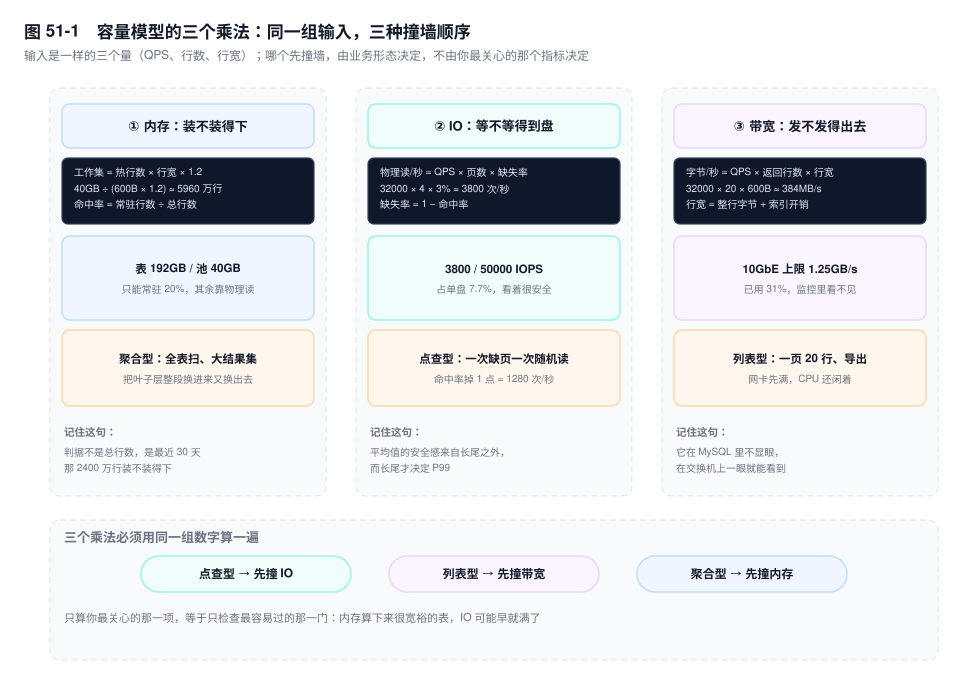
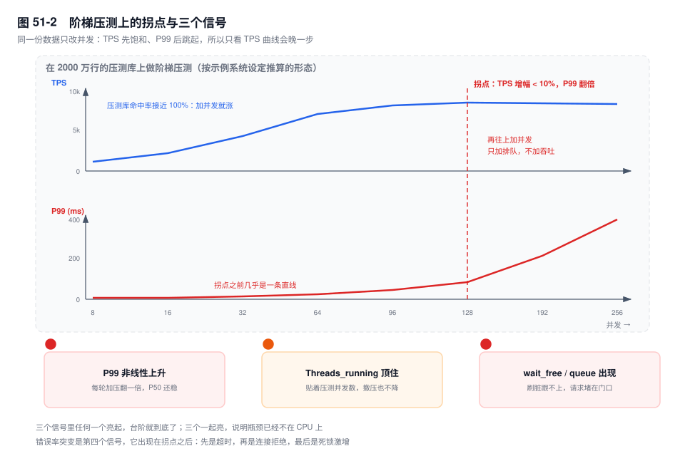

# 第 51 章　容量规划与压测

> **一句话结论**：容量不是"能扛多少 QPS"，是"在多大数据量、多高命中率下，还能把 P99 压在线内"；压测只能证伪，不能证明。

## 51.0 场景：压测 8000 TPS 通过，上线 3000 就崩

上线前一周，评审室的投影上是这张表：sysbench `oltp_read_write`，16 核 64G，压测库 2000 万行，128 并发，8000 TPS，P99 24ms，错误率 0。报告结论写"可支撑线上峰值 2.6 倍"（3000 × 2.6 ≈ 7800），签字。

首日 20:00，峰值写 3000 TPS、读 3.2 万 QPS，P99 从 20ms 涨到 900ms，`Threads_running` 从 20 爬到 180，CPU 45%，`iostat` 的 `await` 从 0.2ms 到 4ms。没人改代码，流量也没有超预期。

差的不是机器，是**那 2000 万行**。2000 万行 × 600 字节 = 12GB，整个库塞得进 40G 的 buffer pool，命中率接近 100%，读全在内存里。线上 3.2 亿行、约 192GB，命中率 97%。3% 听起来是零头，代入算式：`32000 × 4 页 × 3% ≈ 3800 次/秒` 物理读。这 3800 次每一次都要走盘，而盘上的 `await` 是压测时的二十倍。

主线由此立起来：**压测结论的可信度，取决于压测库与生产库在数据量、数据分布、命中率这三项上有多接近。三项不一致时，压测数字只能当相对参考，不能当容量上限。**

## 51.1 容量模型的三个乘法

容量不是一个数，是三个乘法。三个乘法的输入是同一组——QPS、行数、行宽；输出却是三种完全不同的资源。

### ① 内存：装不装得下

```text
工作集 = 热数据行数 × 行宽 × 1.2
```

1.2 是页内碎片、页头页尾、二级索引页的折算，不必精确，它只提醒你：表占的字节数不等于池子要的字节数。

代入示例系统：3.2 亿行 × 600 字节 ≈ 192GB，40GB 的 buffer pool 只能装下 20.8%。**命中率的天花板就在这里，是 20%，不是 99%。** 装不装得下的判据用第 33 章那条：看 B+ 树倒数第二层能否常驻（三层树固定约 950 页、15MB，随便装），真正吃内存的是叶子层。把池子换算成行数更直观：`40GB ÷ (600B × 1.2) ≈ 5960 万行`，是 3.2 亿的 18.6%。

### ② IO：等不等得到盘

```text
每秒物理读次数 = QPS × 单次扫描页数 × (1 − 命中率)
```

`32000 × 4 × 3% ≈ 3840` 次/秒，单盘 5 万 IOPS 的 7.7%。这个数看着安全，但它对"页数"极其敏感：某个报表查询要扫 200 页，它只要 20 QPS（占总量 0.06%）就是 4000 次/秒，一个人吃掉全库的物理读预算。

### ③ 带宽：发不发得出去

```text
每秒返回字节 = QPS × 平均返回行数 × 行宽
```

`32000 × 20 × 600 ≈ 384MB/s`，万兆网卡理论上限 1.25GB/s，已经用掉 31%。这个数字在 MySQL 的监控里基本看不见（`Bytes_sent` 是累计值，很少有人求它的差），但它在交换机上、在跨机房专线上、在代理层上会先撞墙。



### 谁先撞墙，取决于业务形态

点查型（一行、走主键、返回 600 字节）：内存够就全在内存，先撞的是物理读的尾延迟和网络往返。列表型（一页 20 行、范围扫描）：先撞带宽。聚合型（大范围扫、`GROUP BY`）：先撞内存，而且它的伤害是连锁的——把热数据挤出去，命中率掉下来，受害的是同一个实例上的所有业务。

## 51.2 从数据量倒推拆分时间点

不要问"现在要不要分片"，问"还有多少个月"。算式两条：

```text
可容纳行数 = buffer pool × 命中率目标 ÷ 行宽
剩余月数  = (可容纳行数 − 当前行数) ÷ 月增行数
```

代入：`40GB × 0.8 ÷ 600B ≈ 5700 万行`（0.8 的余量与 1.2 的页开销不必叠乘，两者只差 5%，取一个就够）。

当前 3.2 亿行、月增 2340 万（78 万 × 30）：`(5700 − 32000) ÷ 2340 ≈ −11 个月`。

负数不是算错，是这张表早就过了"总量装得下"的阶段。它现在靠的是另一件事：**热数据只占一小部分**。

判据换成热数据。最近 30 天的订单约 2400 万行（78 万 × 30，向上取整），14.4GB，占池子的 36%；按 1.2 折算约 17GB，池子里还剩 23GB 留给 `order_item`（9 亿行，单行 120 字节，热的那一段同样只占小部分）与索引。这个平衡成立，命中率就稳在 97%。

它什么时候破？两条线读得出来：

- **热窗口变长。** `5700 万 ÷ 78 万/日 = 73 天`，这是池子能常驻的订单天数。业务从"查 30 天"改成"查 90 天"，就是 7020 万行、42GB，超过 40GB 的池子，命中率会掉到 90% 以下。
- **出现全量扫描型查询。** 对账、报表、运营导出不看时间窗口，一次扫 3.2 亿行，把叶子层整个换进换出，之后几个小时的命中率都恢复不了。

所以一句话：**拆分的时间点不取决于总行数，取决于"热数据 + 最重的那个查询"能不能同时装下。**

## 51.3 压测工具：它们各自在测什么

`sysbench oltp_point_select` 是纯主键点查。它测的是**锁开销、网络往返、连接调度**，几乎不碰 IO：2000 万行和 3.2 亿行在它眼里差不多，因为每次只碰一个页。所以它压出来的 TPS 是"框架上限"，不是"容量"。

`sysbench oltp_read_write` 是读写混合，一个事务里十几条语句，增删改都占一点。它测的是写路径：redo `fsync`、行锁、purge、二级索引维护。**生产上最先崩的通常是这条**，因为写没法靠加从库分摊。

`--table-size` 与 `--rand-type` 这两个参数决定"真实度"，比选哪个工具更重要。`--table-size` 决定命中率；`--rand-type` 决定冲突率，默认的 `uniform` 下两个事务撞同一行的概率是 `1/行数` 量级，远低于真实业务——真实业务有爆款 SKU、有头部商户。

TPCC 更接近真实交易：有明确的事务边界、有热点、有 90% 读 10% 写的比例约束。代价是准备数据慢，几百 GB 要跑几个小时，schema 也改不动。

真实流量回放最准，前提两条：脱敏，以及**写请求影子化**（写到影子表或影子库）。少任何一条，回放一遍等于把生产的事故重演一遍。

选择顺序不是"哪个更高级"，是**先想清楚要证伪哪个假设**：

- 想证"扛不扛得住峰值写" → `oltp_read_write`，`--table-size` 可以小，因为写路径与数据量关系不大。
- 想证"缓存够不够" → `--table-size` 必须设到生产量级，否则压了个寂寞：2000 万行的库命中率永远 100%，你测的是内存，不是磁盘。
- 想证"锁冲突会不会炸" → `--rand-type=zipfian`，或者自己造热点：把 10% 的请求打到 1% 的 key 上。

## 51.4 TPS 拐点的三个信号

拐点不是"TPS 不再涨"，是"延迟开始非线性上升"。`L = λ × W` 是恒等式（见第 36 章）：并发固定时，吞吐掉一点，延迟必然涨一截，所以延迟开始涨的时候，吞吐已经到顶了。**只看 TPS 曲线，永远晚一步**——TPS 从 8300 掉到 8100 是 2.4%，人眼不敏感，P99 从 92ms 到 420ms 是 4.6 倍。

按示例系统设定推算的形态（非实测）：

| 并发 | TPS | P99 | 平均 W = 并发 ÷ TPS | 判断 |
|---|---|---|---|---|
| 32 | 4200 | 16ms | 7.6ms | 线性区，加并发就加吞吐 |
| 64 | 6900 | 26ms | 9.3ms | 仍在爬，延迟开始松动 |
| 96 | 7900 | 48ms | 12.2ms | 增幅降到 14%，P99 已近翻倍 |
| 128 | 8300 | 92ms | 15.4ms | 拐点：增幅 5%，P99 再翻一倍 |
| 256 | 8100 | 420ms | 31.6ms | 过载：吞吐倒退，P99 涨到 4.6 倍 |

三个信号，按出现顺序：

1. **P99 每轮加压翻一倍，P50 还很稳。** 大部分请求没事，少数踩到了队列尾。这是"有余量但不多"的最后一档。
2. **`Threads_running` 顶着压测并发数不动。** 并发 128 时它也是 128，撤压后不回落——请求全在等，没有一个在算。
3. **`Innodb_buffer_pool_wait_free` 开始增长，或 `SHOW ENGINE INNODB STATUS` 出现 `queries in queue`**（第 39 章）。前者是刷脏跟不上页面分配，后者是 InnoDB 内部线程在门口排队。



错误率突变是第四个信号，它一定出现在拐点之后，三种形态对应三个方向：

- **超时**：`Threads_running` 高而 QPS 不降，是排队型过载，扩容或限流都有效。
- **连接拒绝**（`ERROR 1040`）：`Threads_connected` 撞到 `max_connections`（第 41 章案例一）。先查连接池配置与泄漏，加机器不会让连接数变少。
- **死锁激增**：`Innodb_deadlock_detect` 的检测次数随并发非线性上升（第 20 章）。这是加锁顺序问题，扩容只会让它更频繁。

## 51.5 压测环境与生产的三个偏差，以及修正

**偏差一：数据量小 → 命中率虚高。** 这是唯一能把结论完全反过来的一项。2000 万行 12GB 全在内存，3.2 亿行 192GB 只有两成在内存，同一条 SQL 在两边是两条不同的路径——一次内存查页，一次物理读。修正方式不是乘系数，是**把压测库灌到生产量级**：至少灌到热数据量级（2400 万行），或者直接拿生产的从库做只读压测，写压测仍然在影子库上做。

**偏差二：数据分布均匀 → 锁冲突偏低。** `uniform` 分布下，两个事务撞同一行的概率是 `1/行数`；真实业务里，爆款 SKU 是 2400 次/秒打一行，头部商户一家占两成订单。修正方式是人为造热点：10% 的请求打到 1% 的 key 上，或用 `zipfian`。这一项主要影响写路径的 P99，对 TPS 上限的影响反而小——**它不会让你算错容量，但会让你算漏延迟**。

**偏差三：单机压测 → 没有网络与代理开销。** 生产上多一跳 ProxySQL 或中间件、多一次 TLS 握手、多一层连接池排队。这一项不要精确到毫秒，按量级估：同机房多一跳代理 +0.3~1ms，跨可用区 +1~2ms，TLS 首包握手多两个 RTT。线上比压测多出来的那截延迟，多半出在这里和偏差一。

一条纪律：**修正系数只对"已知偏差"有效。** 知道偏差是命中率，就去改数据量；知道是热点，就去造热点。不知道偏差在哪时乘一个 0.7 的"安全系数"，是自我安慰——它既不能告诉你差在哪，也不能告诉你差多少。

## 51.6 扩容的四条路，各自的代价

| 路 | 解决什么 | 代价 |
|---|---|---|
| 垂直升配 | 读写都缓解一点 | 有天花板；多半要停机（云上部分规格可在线） |
| 加从库 | 只解决读 | 读到的是可能延迟的数据（第 22 章），写不变 |
| 分片 | 写与容量 | 改造成本最高（第 33 章）；跨分片查询与分布式事务的代价永久存在 |
| 上云 | 把运维成本换成钱 | 边界仍要自己守（第 45 章）；单位成本更高 |

决策顺序三步，顺序不能换：

1. **先看瓶颈是读还是写。** 读 → 从库或缓存；写 → 分片或升配。这一步错了后面全错：写瓶颈加三个从库，一点用没有。
2. **再看瓶颈是"单行热点"还是"总量"。** 热点 → 拆桶、改模型、异步化（第 49、50 章），加机器无效，因为热点行在哪个实例上都只有一行；总量 → 加机器或分片才有效。
3. **最后才看钱。** 升配是当天能做完的事，分片是三个月的事，上云是一年的合同。先算时间，再算钱。

## 51.7 关键结论

1. **容量是三个乘法，不是一个 QPS 数字。** 内存看工作集、IO 看缺失率、带宽看返回字节，三项必须用同一组输入算一遍。
2. **命中率的天花板由"池子 ÷ 表大小"决定，不由调优决定。** 192GB 的表配 40GB 的池，天花板就是 20%。
3. **拆分时间点由"热数据 + 最重的查询"倒推，不由总行数倒推。** 总量算出来是负数时，说明这张表早就在靠热数据活着。
4. **压测的作用是证伪。** 通过只说明"在这个数据量、这个分布、这个并发模型下没崩"，不说明能上线。
5. **拐点的第一信号是 P99 非线性，不是 TPS 不涨。** `L = λ × W` 是恒等式，等 TPS 掉头再看，已经晚了一档。
6. **扩容方向由瓶颈类型决定，不由预算决定。** 读→从库，写→分片，热点→改模型；加机器只对"总量型"有效。

## 51.8 实验验证

### 实验一：两轮不同 `--table-size`，看命中率的差别

```bash
# 第一轮：2000 万行（8 张表 × 250 万）
sysbench oltp_read_write --tables=8 --table-size=2500000 \
  --mysql-host=127.0.0.1 --mysql-db=lab51 --mysql-user=root prepare
sysbench oltp_read_write --tables=8 --table-size=2500000 --threads=64 \
  --time=180 --report-interval=30 run

# 第二轮：把 2500000 换成 6250000（5000 万行）重新 prepare，
#         SQL、并发、时长完全不变，只改数据量
```

两轮都在跑的过程中采一次：

```sql
SHOW GLOBAL STATUS WHERE Variable_name IN
  ('Innodb_buffer_pool_read_requests','Innodb_buffer_pool_reads');
```

```text
# 输出形态（未实跑，字段含义以此为准）
2000 万行：read_requests 快速上涨，reads 几乎不动   → 缺失率 < 0.1%
5000 万行：reads 开始按每秒几百增长                 → 缺失率升到 1% 量级
```

判读：两轮的 TPS 差距可能只有 10%，P99 差距可能是 3 倍。**这就是"压测通过"与"能上线"之间的那道缝**——TPS 对命中率不敏感，P99 敏感。

### 实验二：两次采样算物理读速率

```sql
CREATE TEMPORARY TABLE s1 AS
SELECT VARIABLE_NAME, CAST(VARIABLE_VALUE AS UNSIGNED) AS v
FROM performance_schema.global_status
WHERE VARIABLE_NAME IN ('Innodb_buffer_pool_reads',
                        'Innodb_buffer_pool_read_requests', 'Questions');

DO SLEEP(30);

SELECT s.VARIABLE_NAME,
       ROUND((CAST(g.VARIABLE_VALUE AS UNSIGNED) - s.v) / 30, 1) AS per_sec
FROM s1 AS s JOIN performance_schema.global_status AS g
  ON g.VARIABLE_NAME = s.VARIABLE_NAME;
```

```text
# 输出形态（未实跑，字段含义以此为准）
Innodb_buffer_pool_read_requests   128000.0
Innodb_buffer_pool_reads             3800.0
Questions                           34000.0
```

`3800 ÷ 128000 ≈ 3%` 的缺失率；`128000 ÷ 34000 ≈ 3.8`，就是每条语句平均碰 4 个页。**两个比值一对，51.1 里那个算式就落地了**——命中率不是感觉，是这两个计数器的商。

### 实验三：用 `EXPLAIN` + `Handler_read_*` 推一个查询的页访问量

```sql
FLUSH STATUS;
SELECT id, order_no, pay_amount FROM order_main
WHERE buyer_id = 8842 ORDER BY created_at DESC LIMIT 20;
SHOW SESSION STATUS WHERE Variable_name LIKE 'Handler_read%';
```

```text
# 输出形态（未实跑，字段含义以此为准）
Handler_read_key        21     -- 1 次索引定位 + 20 次回表
Handler_read_next       20     -- 沿 idx_buyer_created 顺序扫 20 行
Handler_read_rnd_next    0     -- 没有全表扫
```

判读：`Handler_read_next` 是"碰了多少行"，不是"碰了多少页"。20 行如果挤在相邻的一两个索引页里，页访问量是 2；分散在 20 个页上，页访问量就是 20。容量算式里用的是页数，所以**行数只能当上界**。把 `pay_amount` 换成不在索引里的列，多出来的那些 `Handler_read_key` 就是回表，每次回表至少一次页访问。

## 51.9 常见误区

⚠️ **"压测通过就能上线"**
通过只证明一件事：在那个数据量、那个分布、那个并发模型下没崩。它证伪了"这套代码根本跑不动"，没有证明"生产环境跑得动"。三项偏差里任何一项都能推翻它，而它们都不会出现在压测报告里。正确理解：压测是排除法，不是证明法。

⚠️ **"TPS 越高说明容量越大"**
TPS 是"这台机器在这个数据集上的吞吐"，命中率、并发模型、数据分布全嵌在这个数字里。同一个实例，2000 万行压出 8300 TPS，换成 3.2 亿行的数据集、同样的并发，可能只剩一半多。TPS 只能同环境纵向比（改一个参数前后比），不能跨环境横向比。正确理解：容量要写成一句话——"在 X 行、Y% 命中率下，Z TPS 时 P99 是多少"。

⚠️ **"加机器一定能解决慢"**
加机器只对总量型瓶颈有效。锁热点、单行热点、连接池耗尽、坏执行计划，加机器一样不解决：热点行在哪个实例上都只有一行；池子不够是配置问题；坏计划是索引问题。正确理解：先看 `Threads_running` 与 CPU 的比值，CPU 闲着而线程在排队，加机器等于给排队的人多发号。

⚠️ **"命中率 99% 就说明内存够了"**
命中率是比值，分母越大越好看，也越容易被"全表扫把页读进来只用一遍"刷出来（第 36 章）。同一个 3.2 万 QPS、每次 4 页，99% 是 1280 次/秒物理读，97% 是 3840 次/秒，差三倍。正确理解：命中率要和绝对次数一起看，还要和"这个查询扫了几页"一起看。

## 51.10 生产 Checklist：容量评审的 10 项

- [ ] 三个乘法都算过，且有数：工作集（2400 万 × 600B × 1.2 ≈ 17GB）、物理读（32000 × 4 × 3% ≈ 3800/s）、带宽（32000 × 20 × 600B ≈ 384MB/s）
- [ ] `buffer pool ÷ 表大小` 算过吗？40GB ÷ 192GB = 20.8%，这就是命中率天花板
- [ ] 热数据装得下吗？最近 30 天 2400 万行 / 14.4GB 占池子 36%、折算 17GB；改查 90 天就是 42GB，超了
- [ ] 拆分时间点用"热数据 + 最重查询"倒推过吗？5700 万 ÷ 78 万/日 = 73 天
- [ ] 压测库数据量 ≥ 生产热数据量（2400 万行）吗？不到，命中率这一项等于没测
- [ ] 压测分布是 `uniform` 还是造了热点？写路径的 P99 只有在热点下才真实
- [ ] 拐点定在哪一档：P99 翻倍而 TPS 增幅 < 10% 的那一档，它的前一档就是容量上限
- [ ] `Threads_running ÷ 核数` 记录了吗？持续超过 2~3 倍即过载，且要区分是"在算"还是"在等"
- [ ] 错误率三种形态分得清吗：超时（限流）、连接拒绝（池子 / `max_connections`）、死锁（加锁顺序）
- [ ] 扩容方向与周期写清楚了吗：读→从库、写→分片、热点→改模型，各附改造周期

## 51.11 延伸

- **上一章**：第 50 章的热点行场景与本章的 IO、带宽两式无关，它只受"单行并发上限"约束。
- **关联章节**：第 33 章（容量判据与分片时间点）、第 36 章（`L = λ × W` 与 USE）、第 37 章（状态变量求差）、第 39 章（`queries in queue`）、第 41 章案例一（`max_connections`）、第 45 章（上云的边界）、第 22 章（从库延迟）。
- **面试追问**：
  - "线上 3000 TPS 就抖，压测 8000 通过，怎么解释？" → 先比数据量与命中率。命中率差三个点，物理读就是每秒几千次，延迟全从这里来。
  - "怎么判断该不该分片？" → 用热数据 + 最重的那个查询倒推还剩多少天；总量算不出正数时，说明判据早就不是总量。
  - "压测报告里你最想看哪个数？" → P99 随并发变化的曲线，以及压测库的行数与命中率。只有 TPS 的报告没有信息量。
- **官方文档**：`sysbench` 的 `--table-size` / `--rand-type`、`Performance Schema Status Variable Summary`（`Innodb_buffer_pool_reads`、`Innodb_buffer_pool_wait_free`）、`SHOW ENGINE INNODB STATUS` 的输出说明、`Server Status Variables`（`Threads_running`、`Max_used_connections`）。
