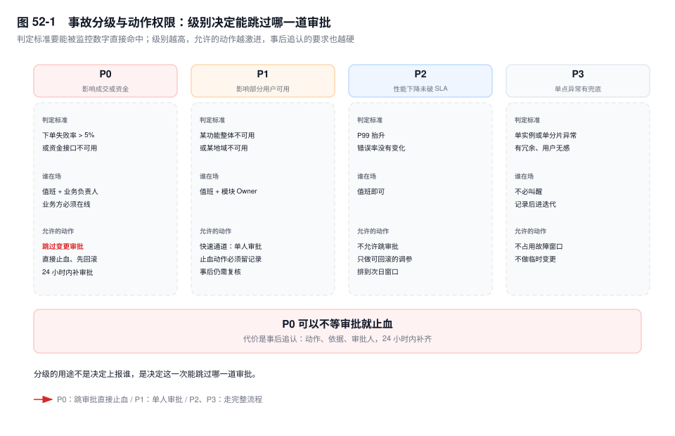
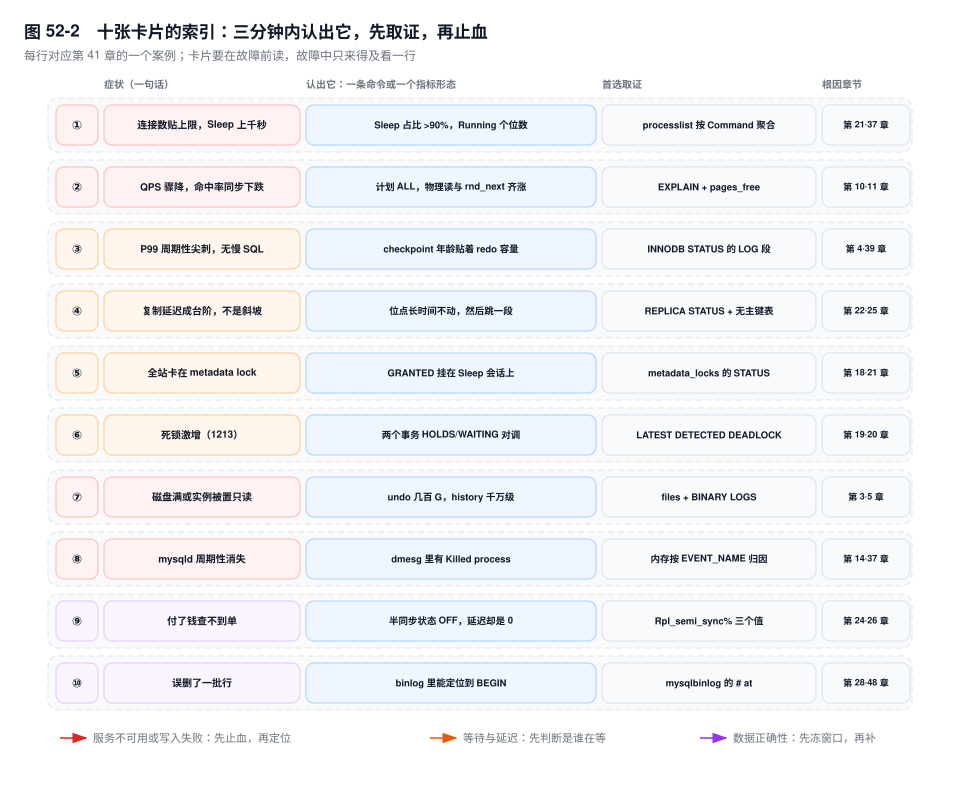
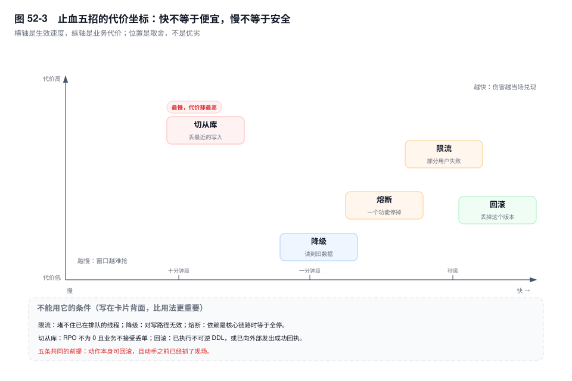

# 第 52 章　故障应急与 SOP

> **一句话结论**：事故现场的信息永远不够做一个正确的决定，SOP 能给的不是答案，是一个能快速排除的顺序，和一个错了也能退的止血动作。

## 52.0 场景：一个 P0 的 47 分钟

20:03，下单成功率从 99.8% 掉到 61%。20:50 恢复，中间四十七分钟，值班的三个人做了十几个动作，其中三个是错的，而每一个在当时都合理。

| 时间 | 当时知道的 | 事后才知道的 |
|---|---|---|
| 20:03 | 告警：下单失败率 38%，错误码里 `1205` 和网关 504 混在一起 | 19:55 启动的库存校准任务，此刻走到爆款 SKU，锁住那一行直到事务结束 |
| 20:05 | 主库 CPU 38%，QPS 从 3.2 万掉到 1.1 万，`Threads_connected` 正常 | CPU 不高是因为线程都在等锁，不是在算 |
| 20:08 | 报表从库延迟 400 秒，判断"读库拖累了下单"，重启从库 SQL 线程 | 那台从库在回放前一天的归档 `DELETE`，与下单无关 |
| 20:16 | 从库延迟归零，成功率没动 | 那个归档事务本来就快放完了，重启只是让它重放一遍 |
| 20:23 | 加限流：下单入口 3000 → 1200 QPS | 客户端 SDK 对 429 与超时都重试三次，到锁队列的请求比限流前更多 |
| 20:31 | 成功率跌到 58% | 重试把入口 QPS 补回了 2800 |
| 20:38 | 有人第一次看 `Threads_running`：190 | 170 多个线程的 `State` 是 `updating`，全部在等同一行的 X 锁 |
| 20:42 | `data_lock_waits` 指向同一个事务，`trx_rows_modified` 十八万 | 它已经改了十八万行，剩下的还要接着改，锁不会中途释放 |
| 20:44 | `KILL` 那个会话 | 回滚十八万行花了近三分钟，这期间锁不释放 |
| 20:50 | 成功率回到 99.8% | 现场一直在 `Threads_running` 里，隔了三十五分钟才被看见 |

三个错误动作的共同点，是都作用在"最先看到的那个指标所在的层"：从库延迟治延迟，入口 QPS 治 QPS。两个数都是结果，结果那一层没有病人。这次故障不在那十个案例里，判据却是同一个：先问这个指标是谁产生的。

## 52.1 分级与交接：把"严重"变成可判定的

分级只回答一个问题：这一次，谁可以不等审批就动手。

- **P0**：影响成交或资金。下单失败率 > 5%，或支付、退款、账单这类资金接口不可用。
- **P1**：影响部分用户可用。某个功能整体不可用，或某个地域不可用，其余正常。
- **P2**：性能下降但未破 SLA，错误率没有抬升。
- **P3**：单点异常，有冗余兜底，用户无感。

分级的用途不是"上报谁"，是"决定用哪套动作"。P0 允许跳过变更审批直接止血——每多等十分钟，损失的是真实成交；P2 不允许，因为 P2 的"止血"通常是调参，没有定位就调参，大概率把一个变成两个。升级路径写在同一张表上：P0 十五分钟不收敛升级到架构组，P1 一小时；跨团队依赖由值班直接呼叫对方 on-call，不经过管理层。



on-call 交接必须给三样东西，缺一样就等于让接班人从零重建你的排除过程。

**当前假设**　我认为是什么，一句话。"我怀疑是库存那一行的锁，不是容量。"

**已排除项**　我试过什么，读数是多少，为什么排除。"重启从库后延迟归零、成功率没动，所以不是读库。"

**下一步计划**　你接手先看哪条命令、看什么值。"先看 `Threads_running` 和 `data_lock_waits`，如果都指向同一个事务就准备 KILL。"

"你看着办"式交接是事故二次延长最常见的原因：它省下交班人三分钟，花掉接班人二十分钟，而这二十分钟正好是事故最贵的二十分钟。

## 52.2 十张处置卡片：三分钟内认出它

十张卡片与第 41 章的十个案例一一对应，症状、判据、止血动作都取自那里，只是压成了能贴在显示器边的形状。卡片要在故障前读——故障中你只来得及看一张。

### 卡片 1：连接数贴上限，`Sleep` 上千秒

**认出它**：`SELECT Command, COUNT(*) n, MAX(Time) max_idle FROM information_schema.processlist GROUP BY Command;`，`Sleep` 占九成以上、`max_idle` 四位数。

**三分钟判断**：`SHOW GLOBAL STATUS LIKE 'Threads_running';` 若 `Sleep` 上千而它是个数，是池子漏了；两者同高，才是流量。

**止血**：抬 `max_connections` 买窗口（只对新连接生效，代价是内存与线程开销上升），同时 `KILL` 掉 `Time > 3600` 的 `Sleep` 连接，再修 `finally`；误杀池内长连接会让应用重连一次。

**根因指向**：第 21 章、第 37 章。

### 卡片 2：QPS 骤降，命中率同步下跌

**认出它**：`Innodb_buffer_pool_reads` 与 `Handler_read_rnd_next` 同时暴涨，`Innodb_buffer_pool_pages_free` 见底。

**三分钟判断**：对可疑 SQL 跑 `EXPLAIN`：`type` 从 `range` 变 `ALL`、`rows` 是表行数量级，是计划变了，不是容量不够。

**止血**：`ANALYZE TABLE order_main` 让统计信息回到真实分布，再给这条 SQL 加 `FORCE INDEX` 兜底；代价是采样期有 IO 抖动，命中率要靠真实流量重新预热十几分钟。

**根因指向**：第 10 章、第 11 章。

### 卡片 3：P99 周期性尖刺，慢日志里没有对应 SQL

**认出它**：`SHOW ENGINE INNODB STATUS` 的 `LOG` 段，`Log sequence number` 减 `Last checkpoint at` 长期贴着 redo 容量。

**三分钟判断**：`SHOW GLOBAL STATUS LIKE 'Innodb_buffer_pool_wait_free';` 两次采样求差，若只在尖刺窗口内增长，是空闲页见底、用户线程在替 page cleaner 刷脏，不是网络。

**止血**：`innodb_io_capacity` 按设备实测 IOPS 的 50%~70% 抬，`innodb_redo_log_capacity` 放大 `[8.0.30+]`；代价是 IO 打满会连累同机其它查询，改完要盯两轮写入突发。

**根因指向**：第 4 章、第 39 章。

### 卡片 4：复制延迟成台阶，不是斜坡

**认出它**：`SHOW REPLICA STATUS` 里 `Replica_SQL_Running_State` 是 `Waiting for dependent transaction to commit`，`Exec_Source_Log_Pos` 长时间不动然后跳一段。

**三分钟判断**：`SHOW CREATE TABLE trade.stock_flow\G` 看不到 `PRIMARY KEY`，写集就算不出来，这批事务的回放退化成串行，加核只会让 CPU 曲线更平。

**止血**：先摘掉这台从库的读流量（代价是主库读压力上升），把批量更新按几千行切批；补主键走 `pt-online-schema-change`，单独排期。

**根因指向**：第 22 章、第 25 章、第 30 章。

### 卡片 5：全站卡在 `Waiting for table metadata lock`

**认出它**：`performance_schema.metadata_locks` 里有一行 `LOCK_TYPE=SHARED_READ`、`LOCK_STATUS=GRANTED`，`OWNER_THREAD_ID` 指向一个 `Command=Sleep` 的连接。

**三分钟判断**：

```sql
SELECT OBJECT_NAME, LOCK_TYPE, LOCK_STATUS, OWNER_THREAD_ID
FROM performance_schema.metadata_locks
WHERE OBJECT_SCHEMA = 'trade' AND OBJECT_NAME = 'order_detail';
```

同时看到 `GRANTED` 与 `PENDING`，就是队列前面堵着一个没提交的事务，不是 DDL 在跑。

**止血**：按 `OWNER_THREAD_ID` 找到 `PROCESSLIST_ID`，`KILL` 那个 `GRANTED` 且 `Sleep` 的会话——不是杀 `Waiting` 的那些；下手前看 `innodb_trx` 的 `trx_rows_modified`，回滚可能比等待更久。

**根因指向**：第 18 章、第 21 章。

### 卡片 6：死锁激增（1213）

**认出它**：`SHOW ENGINE INNODB STATUS` 的 `LATEST DETECTED DEADLOCK` 段，两个事务的 `HOLDS` 与 `WAITING` 刚好对调。

**三分钟判断**：两次采样 `Innodb_deadlocks` 求增速；若两个事务都是单行等值更新、锁模式都是 `X` 记录锁、没有间隙锁，就是加锁顺序问题，降隔离级别消不掉它。

**止血**：重试加退避与次数上限（代价是延迟放大），并把多行更新按 `sku_id` 排序后统一遍历顺序；后者要发布，不是当场能完成的止血。

**根因指向**：第 19 章、第 20 章。

### 卡片 7：磁盘满（1114）或实例被置为只读

**认出它**：写入报 `ERROR 1114`；`information_schema.files` 里 `undo_001`、`undo_002` 各几百 GB，`SHOW BINARY LOGS` 四百多个文件。

**三分钟判断**：`SHOW ENGINE INNODB STATUS` 的 `History list length` 在千万级，就是长事务钉住了 purge 水位；业务数据一个月涨不到 200G 而盘吃掉 1T，不是"数据涨太快"。

**止血**：先扩盘争取窗口，再 `KILL` 长事务、盯 `History list length` 的下降速率；`PURGE BINARY LOGS` 前确认从库已越过这些文件。**不要**上来就 KILL：回滚大事务要读 undo、写磁盘，可能把仅剩的空间吃光。

**根因指向**：第 3 章、第 5 章、第 28 章。

### 卡片 8：`mysqld` 周期性消失

**认出它**：`dmesg -T | grep -i "killed process"` 里有 `mysqld`，重启后一周无事，时间点规律。

**三分钟判断**：按 `EVENT_NAME` 聚合 `performance_schema.memory_summary_by_thread_by_event_name`，若排序与临时表两项的峰值乘以当时的 `Threads_running` 才和 RSS 对得上，是预算超支，不是泄漏。

**止血**：给导出类任务加并发闸门（代价是导出排队变慢），`KILL` 掉占着排序内存的会话；`sort_buffer_size` 调小只对新连接生效，存量连接要断才生效。

**根因指向**：第 14 章、第 37 章、第 40 章。

### 卡片 9：付了钱查不到单

**认出它**：`SHOW GLOBAL STATUS LIKE 'Rpl_semi_sync%';` 里 `Rpl_semi_sync_source_status` 是 `OFF`，而 `SHOW REPLICA STATUS` 一切正常、`Seconds_Behind_Source = 0`。

**三分钟判断**：`Rpl_semi_sync_source_no_tx` 是否持续增长；增长说明有一段提交没等任何副本确认，那段时间的 RPO 不是 0。"复制正常"与"数据一致"是两件事。

**止血**：先确认状态回到 `ON`（否则补完再丢一次），再按 GTID 差集从主库 binlog 重放缺口；补数据期间把 binlog 保留期临时拉长，代价是磁盘。

**根因指向**：第 24 章、第 26 章。

### 卡片 10：误删了一批行

**认出它**：`mysqlbinlog -v --base64-output=DECODE-ROWS mysql-bin.000887 | grep -n "DELETE FROM"`，往上找最近的 `BEGIN`，它的 `# at` 就是恢复刀口。

**三分钟判断**：确认三件事——有全备、备份点到误操作之间 binlog 无缺口、误操作之后没有别的 DDL；三条都成立就走"临时实例 + `--stop-position`"补行，**不要**回滚整个实例。

**止血**：立刻 `STOP REPLICA SQL_THREAD` 冻住延迟从库的窗口（若部署了），同时扩 binlog 保留期；恢复在临时实例上做，核对行数与金额后再按主键导回。

**根因指向**：第 28 章、第 48 章。



## 52.3 止血五招，每一招的代价

止血是让伤害停止扩大，不要求系统恢复原状。五招都是买时间，不是修复。

**限流**　丢掉一部分请求，保住系统整体。代价是用户直接看到失败，被丢的请求里有真实成交。适用于下游被打挂或入口超过容量；它堵不住已经进了线程池、卡在锁上的请求。

**熔断**　对一个依赖停止调用，牺牲一个功能保整体。代价是业务受损；判据是"这个依赖挂掉时，主链路能不能不带它跑"，核心依赖不能熔。

**降级**　读旧数据、关非核心功能。代价是数据可能过期，适用于读路径；对写路径无效——写要么成功要么失败，没有"降级地写"。

**切从库**　主库不可用时换写入位置，代价是 RPO，丢掉最后一次成功传输之后的事务（第 26 章）。适用于端口不可达这类"确定不在了"，不适用于"还活着但不能服务"的假死。

**回滚**　最快也最干净，前提是上次发布可回滚，且没有不可逆的数据变更：DDL 已执行、消息已发出、外部账单已回执。



落到选择上是一张五行的表：

| 现象 | 首选 | 不能用它的条件 |
|---|---|---|
| 主库 CPU 打满，热点 SQL 未定位 | 限流 | 切从库：同样的 SQL 会打到新主，两台一起满 |
| 账单服务超时，拖住下单线程 | 熔断账单调用 | 限流入口：堵的是新请求，已被拖住的线程不会释放 |
| 报表把 Buffer Pool 冲干净 | 降级：摘掉报表流量 | 切从库：报表同样跑在新主上 |
| 主库端口不可达 | 切从库 | 先重启：假死时重启会回滚未落盘事务，而新主已提升 |
| 发布后十分钟错误率上升 | 回滚 | 已执行不可逆 DDL，或已向外部发出成功回执 |

一条反直觉的：**重启不是止血手段，是"放弃现场"。** 重启会丢掉 `SHOW ENGINE INNODB STATUS` 里的 `LATEST DETECTED DEADLOCK`、`data_lock_waits` 里的锁等待链、`performance_schema` 的历史表（环形缓冲，进程一退就清空），而这些是根因的唯一证据。只有在"服务完全不可用、且这个故障已知重启有效"时才重启，且重启前必须先抓现场：`SHOW FULL PROCESSLIST`、`SHOW ENGINE INNODB STATUS`、关键状态变量、`p_s` 快照，四样存成一个文件再动手。

## 52.4 高危操作清单与双人复核

- **`KILL`**　先分清杀的是语句还是会话（`KILL QUERY` 只停当前语句，`KILL CONNECTION` 连会话一起断），再确认杀的不是池里的复用连接——杀了池立刻重连，等于没杀。回滚代价看 `innodb_trx` 的 `trx_rows_modified`。
- **`DROP` / `TRUNCATE`**　不直接删。先 `RENAME TABLE t TO t_bak_20261113`，观察一天，确认没有作业、没有对账依赖，再删。
- **无 `WHERE` 的 `UPDATE` / `DELETE`**　双保险：会话开 `sql_safe_updates`（没 `WHERE` 或不走索引直接报错），执行前用同样的条件 `SELECT COUNT(*)` 数一遍行数，和预期比。
- **主从切换**　隔离完成的判据是 `information_schema.innodb_trx` 清空，不是 `super_read_only = ON`——后者不 kill 会话，也不中断已在跑的事务（第 26 章）。
- **改参数**　先确认作用域：`SET GLOBAL` 是只对新连接生效还是全局生效，静态参数（如 `innodb_buffer_pool_instances`）必须重启——要重启的方案不能用来止血。

双人复核的实质不是"两个人签字"，是**第二个人独立执行一遍判断**：他能不能从同样的证据得出同样的结论。一个人念、一个人执行的"复核"复的是手不是脑，出错时两个人一起错。所以复核是第二个人自己跑一遍 `iostat`、自己算一次 checkpoint 年龄，再说"我算出来也是 78%"。

## 52.5 复盘：双栏时间线是唯一能防止事后诸葛亮的工具

复盘最常见的破坏，是拿事后知道的信息评价当时的动作："从库延迟明显是结果，怎么会去重启它？"——在 20:08 那个位置，左栏里只有"延迟 400 秒"这一条证据。

所以时间线要写成两栏并排：左栏"当时知道的"（告警、看到的指标、做过的动作），右栏"事后才知道的"（真正的原因）。**只有左栏能用来评价决策**，因为决策只能用当时的信息评价。右栏的用途是找出"当时多看哪一个数，结论就会不同"，那个数就是下一次该进监控的东西。

三样必须有：

**影响面**　用户数、订单数、金额，三个口径分别给。用户数按去重买家算，订单数按失败单号算，金额按应付总额算。三者不能互相换算，只给一个等于没给。

**根因**　5 Why 要追到机制层。以第 41 章的误删为例：为什么删了 40 万行 → `DELETE` 少了时间条件；为什么少了条件还能执行 → 会话没开 `sql_safe_updates`、SQL 平台不做 `WHERE` 校验；为什么开发有这个权限 → 生产账号沿用建库时的授权，之后没有复核。停在"某人没注意"，等于没做。

**改进项**　每条要有 Owner 和验收标准。"加强监控"不是改进项，"对 `Sleep > 60s` 的连接数加曲线，阈值 200 持续 5 分钟告警，Owner 李某，验收：下一次泄漏演练中 3 分钟内触发"才是。

**复盘的产出不是一份文档，是 N 条被排进迭代的改动。** 没有进迭代的复盘，半年后会以同样的形状再来一次，只是换了一批值班的人。

## 52.6 稳定性建设：演练必须排期，否则不会发生

三类演练，验证的东西各不相同：

**切换演练**　每季度。验证 RTO 的分段耗时，以及一个常忽略的问题：切换之后旧主能不能回滚回来。不能回滚的切换，等于单程票。

**备份恢复演练**　每月。验证 RPO，以及"恢复出来的数据是不是你以为的那一刻"。备份成功不等于能恢复，恢复成功不等于恢复点对——第 28 章花二十分钟找的那个数字，就是它。

**混沌演练**　按需。注入延迟、丢包、磁盘满、依赖超时，验证降级逻辑真的会触发。降级开关最常见的失败是"写了没生效"：配置没下发、路径没走到、开关读的是缓存。

关键在排期。演练最大的敌人不是技术难度，是"这周太忙了下周吧"——这句话可以说十二个月。所以要占日历、有 Owner、有记录：时间戳、参与人、RTO 五段、恢复点、问题编号。

一条判据：**没演练过的预案等于没有预案；演练过但没记录时间的预案，等于不知道它还能不能用。**

## 52.7 关键结论

1. **事故现场的信息永远不足以支持一个正确的决定，SOP 的价值是给出排除顺序，不是给出答案。**
2. **止血与根因是两条并行线。** 拖长事故的不是找不到根因，是"根因不明"时拒绝止血。
3. **P0 与 P2 的差别不是严重程度，是动作权限。** 分级决定能不能跳过审批，不决定叫谁。
4. **重启不是止血，是放弃现场。** 它销毁的锁等待链和 `p_s` 历史，是根因的唯一证据。
5. **交接的失败形态是"你看着办"。** 假设、已排除项、下一步，缺一条就等于把事故重启一次。
6. **排障能力的上限不是知道多少条命令，是能不能在信息不足时说出"我现在的假设是什么、哪个观测能推翻它"。**

## 52.8 实验验证：把演练做成可执行的

### 实验一：手工制造一次 MDL 阻塞

```sql
-- 会话 A：开事务、读一张表，然后挂着不提交
BEGIN;
SELECT COUNT(*) FROM trade.order_detail WHERE order_id = 202611110001;

-- 会话 B：加索引，会卡在 MDL 队列里
ALTER TABLE trade.order_detail ADD INDEX idx_created (created_at);

-- 会话 C：另一个普通查询，也会被卡住（MDL 队列写优先）
SELECT * FROM trade.order_detail WHERE order_id = 202611110002;
```

```sql
SELECT OBJECT_NAME, LOCK_TYPE, LOCK_STATUS, OWNER_THREAD_ID
FROM performance_schema.metadata_locks
WHERE OBJECT_SCHEMA = 'trade' AND OBJECT_NAME = 'order_detail';
-- 输出形态（未实跑，字段含义以此为准）
-- order_detail  SHARED_READ   GRANTED  48211
-- order_detail  EXCLUSIVE     PENDING  48390
-- order_detail  SHARED_READ   PENDING  48402
```

**读法**：第三行是会话 C，它既没改表也没等 DDL，同样卡住了——MDL 队列写优先，后来的共享锁也要排在 `PENDING` 的排它锁后面。该杀的是 `48211`，不是 `PENDING` 的那两个。

### 实验二：`KILL` 一个长事务，看它不回滚完就不放锁

```sql
-- 会话 A
BEGIN;
UPDATE trade.stock SET qty = qty - 1 WHERE sku_id = 8842 AND warehouse_id = 3;
-- 不提交

-- 会话 B：同一行，开始等锁
UPDATE trade.stock SET qty = qty - 1 WHERE sku_id = 8842 AND warehouse_id = 3;

-- 会话 C：杀掉 A
KILL 48211;
```

```sql
SELECT trx_id, trx_state, trx_rows_modified, trx_mysql_thread_id
FROM information_schema.innodb_trx;
SHOW PROCESSLIST;
-- 输出形态（未实跑，字段含义以此为准）
-- trx_state = ROLLBACK, trx_rows_modified = 1, trx_mysql_thread_id = 48211
-- Id 48212  State: updating（仍在等锁）
```

**读法**：`KILL` 只打断语句并触发回滚，锁要等回滚结束才释放。改一行几乎瞬间完成，改十八万行要读 undo、写磁盘——"杀了它就好了"是需要先算的假设，不是动作。

### 实验三：模拟从库延迟，并验证切换判据

```sql
-- 从库
STOP REPLICA;
CHANGE REPLICATION SOURCE TO SOURCE_DELAY = 600;
START REPLICA;
SHOW REPLICA STATUS\G
-- 输出形态（未实跑，字段含义以此为准）
-- SQL_Delay: 600   SQL_Remaining_Delay: 487
-- Seconds_Behind_Source: 逐步增长
```

```sql
-- 老主：只开只读，不杀会话
SET GLOBAL super_read_only = ON;
-- 会话 A（开启前就执行过 UPDATE、尚未提交）
COMMIT;          -- 仍然成功
SELECT COUNT(*) FROM information_schema.innodb_trx;   -- 不为 0
```

**读法**：`super_read_only = ON` 只拒绝新语句，不中断已建立的事务。切换脚本若以"只读已开"作为隔离完成的判据，老主就能在这个窗口里多提交一段。判据是 `innodb_trx` 清空——先 `KILL`，轮询到 0 再撤 VIP。

## 52.9 常见误区

⚠️ **"先找根因再止血"**

P0 的每一分钟都在损失成交，而根因所需的观测往往超过五分钟能做的事。做法是两条线并行：止血动作必须可逆、必须留现场，先做可逆的那个，根因在后面追。顺序倒过来，事故时长会翻倍。

⚠️ **"重启能解决大部分问题"**

重启让现象消失，不改变机制。同一个泄漏点、同一张无主键表、同一条坏计划，重启后原样存在，只是下次发作时间被推迟。更贵的是它销毁证据：锁等待链、`LATEST DETECTED DEADLOCK`、`p_s` 历史表，进程一退全没。

⚠️ **"复盘就是写清楚谁操作错了"**

人是可替换的变量，机制不换，换个人照样犯。"某人在生产执行了 `DELETE`"只能作为事实记录；有价值的是"为什么这个账号有 `DELETE` 权限、为什么没有 `WHERE` 校验"。复盘的对象是判断依据和权限边界，不是手指。

⚠️ **"加了监控就不会再犯"**

第 41 章的半同步案例是反例：`Rpl_semi_sync_source_status` 一直存在，只是被归进"复制是否正常"那一族，而那一族显示"正常"。监控的价值取决于有没有人看、有没有阈值、有没有指定谁响应，不取决于有没有采集。

⚠️ **"演练是形式主义"**

演练验证的从来不是数据库能不能切，是脚本之外的东西：应用会不会重连、DNS 缓存过没过期、权限在新实例上有没有、降级开关真的会触发吗。这些只有跑一遍才知道，而它们恰好是 RTO 的大头（第 26 章）。

## 52.10 生产 Checklist：值班交接的 9 项

- [ ] 影响面三口径已给：受影响买家数、失败订单数、涉及金额，附统计时间窗
- [ ] 当前假设写成一句话，并附上"哪个观测能推翻它"
- [ ] 已排除项带读数：试过什么、结果是什么、为什么排除
- [ ] 已执行的变更列全：谁、几点、改了什么参数、杀了哪个会话
- [ ] 现场快照已落盘：`PROCESSLIST`、`INNODB STATUS`、`p_s` 关键表、参数
- [ ] 未拆的定时炸弹已说明：延迟从库窗口、binlog 保留期、临时扩容
- [ ] 下一次检查的时间与检查项已约定，升级对象已通知，并给出下次更新时间
- [ ] 复盘 Owner 与时间已定，改进项有工单号或迭代号
- [ ] 接班人复述一遍假设与下一步，交班人确认后才离开

## 52.11 延伸与收尾

- **关联章节**：第 41 章（十个案例的完整叙事）、第 36 章（三层定位法）、第 37 章（指标与比值）、第 39 章（`INNODB STATUS` 读法）、第 26 章（切换与 RTO）、第 28 章（PITR）、第 48 章（权限与审计）、第 21 章（长事务）。
- **面试追问**：
  - "下单失败率 30%，你先做什么？" → 先确认错误码与影响面（读还是写、单库还是全站），再做可逆止血；同时抓现场。不要先 `EXPLAIN`。
  - "`KILL` 了长事务，锁为什么还在？" → 回滚要读完 undo、写完磁盘才释放；`trx_state` 在 `ROLLBACK` 期间行锁一直持有。
  - "复盘为什么必须写两栏？" → 决策只能用它当时拥有的信息评价；单栏时间线写出来，一定会变成拿结果倒推过程。
- **官方文档**：`MySQL Server Error Reference`（1040 / 1114 / 1205 / 1213）、`Performance Schema`（`metadata_locks`、`data_lock_waits`）、`InnoDB Locking and Transaction Model`、`Point-in-Time Recovery`、`Semisynchronous Replication`。

写到这里，五十二章走完了。读者手上该有的不是一个方案库——方案会过期，参数会变；而是一套顺序：看到现象，先问它是谁产生的；找到那一层，再问什么观测能把它和另一种解释分开；确认之后才动手，先想好退路。

剩下的四件事书里给不了。on-call 的肌肉记忆，只有在凌晨被叫起来时才长出来；大规模数据的体感，只有在 3 亿行上跑错一次计划才知道；源码级的能力，只有顺着 `trx0` 读过一遍才能建立；组织与取舍，只有被业务目标和预算同时挤压过才做得出来。

书到这里结束，排障从下一个报警开始。
